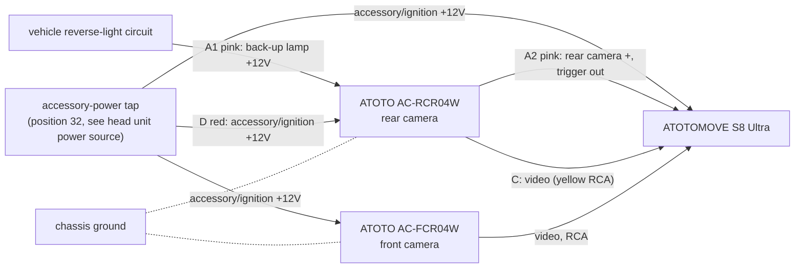
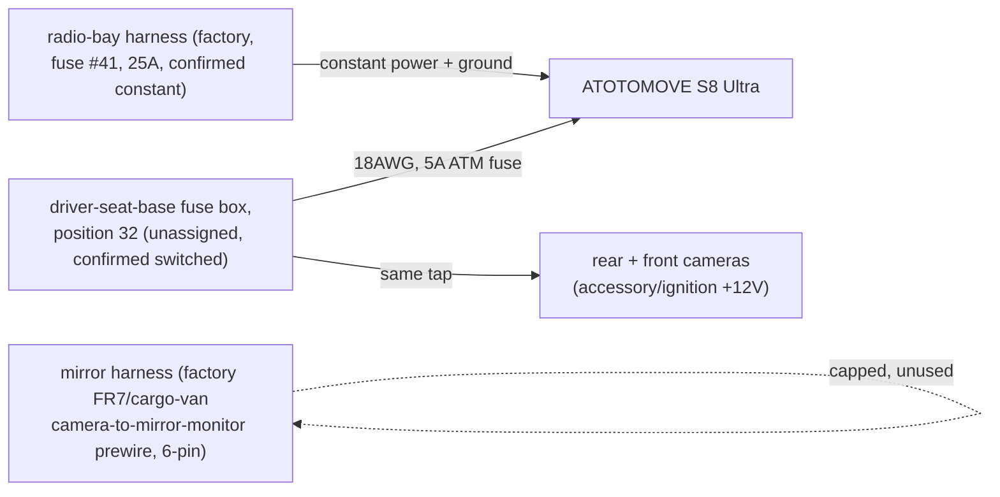
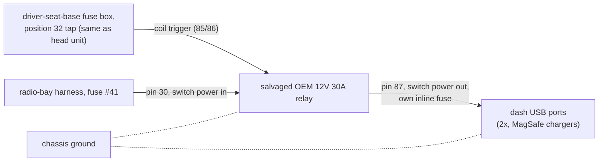
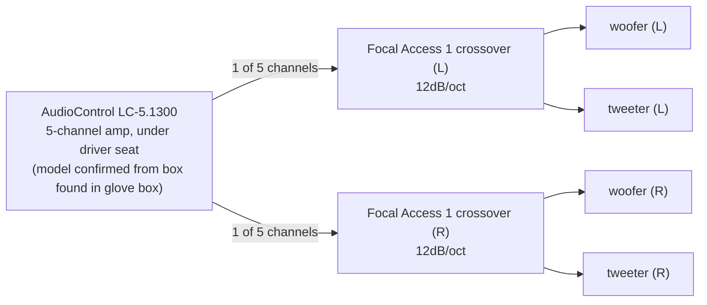

# audio plan

last updated: 2026-10-12

one section per subsystem, each leading with its diagram, then an installation checklist (ordered, check off as done), then a supplies checklist (`[x]` in hand, `[ ]` still needed). open questions that anchor to one specific line are tagged inline as `(verify: ...)`; ones that don't are in "open questions" at the end. rejected or settled-either-way design alternatives are in "decided" at the end, so they don't get re-proposed.

## camera wiring

wiring confirmed 2026-10-12 against the actual manufacturer manuals ([rear camera](../reference/ATOTO_AC-RCR04W.pdf), [front camera](../reference/ATOTO_AC-FCR04W.pdf), product pages: [S8G1109UN head unit](https://www.eproductcare.com/zcNT), [AC-RCR04W](https://www.eproductcare.com/Ab5B), [AC-FCR04W](https://www.eproductcare.com/w545)) — these superseded an earlier, wrong assumption sourced from forum posts (which described capping the camera's pink wire and wiring the vehicle's reverse light straight to the head unit's pink wire instead; that is not how this specific camera is designed). per the real diagram, the rear camera has **two separate pink wires**: **A1**, labeled "to the back-up lamp (+12V)," runs straight to the vehicle's reverse-light circuit and is live only when actually in reverse; **A2**, labeled "rear camera+," is the camera's own trigger output to the head unit's own "rear camera +" input, and is unrelated to A1 — the pink-to-pink (A2-to-head-unit) connection already made is correct as-is.

### installation

- [x] mount and wire the head unit (ATOTOMOVE S8 Ultra)
- [x] mount and wire the front-facing camera (ATOTO AC-FCR04W) — video to head unit
- [x] mount and wire the rear-facing camera (ATOTO AC-RCR04W), replacing the stock rear camera
- [x] rear + front camera accessory/ignition (+12V) → the accessory-power tap at position 32 (see "head unit power source" below), same source the head unit itself now uses
- [x] rear camera video (yellow male RCA) → head unit rear camera input (yellow female RCA); front camera video → head unit front camera input
- [x] rear + front camera chassis ground → established
- [x] rear camera "rear camera +" (A2, pink) → head unit "rear camera +" (pink) — confirmed correct per the real manual: this is the camera's own trigger output to the head unit, separate from the A1 reverse-light wire below
- [x] both cameras confirmed operational via the DVR app (live feed present, power/ground/video all good) — 2026-10-12
- [x] **resolved**: rear camera wasn't activating in reverse because wire **A1** ("to the back-up lamp (+12V)") was actually spliced into the **brake** light circuit, not the reverse light — confirmed by lifting off the brake pedal while in reverse (parking brake set) and watching which wire stayed live. a Mercedes towbar fitting manual for this van ([MB-098-07U](https://www.ecs-electronicsuk.co.uk/ecsdata/manuals/MB09807U.pdf)) independently confirmed the brake-circuit wire color (blue/red), corroborating the miswire. re-spliced A1 to the correct reverse-light wire, identified the same way (live only with foot off the brake, transmission in reverse). camera now activates reliably in reverse — 2026-10-12.
- [x] rear + front cameras, head unit, and all new wiring wire-tied and buttoned up — 2026-10-12
- [ ] **new, minor issue**: slight noise on the rear camera's video feed. prime suspects, in order: (1) ground loop — camera's ground point may have moved during this rewiring, check it's a clean, low-resistance chassis ground; (2) the new accessory-power wire or reverse-light wire now routed parallel to the video RCA run for some distance — separate them or cross at 90°; (3) RCA connector seating; (4) alternator whine, if noise tracks with engine RPM. not yet diagnosed further.

### supplies

- [x] [ATOTOMOVE S8 Ultra head unit](https://www.amazon.com/dp/B0FCXLPTCB), 10.1" — android head unit, wireless carplay/android auto
- [x] [ATOTO AC-FCR04W front camera](https://www.amazon.com/dp/B0DKT4XJXS), 1080P, 150° FOV
- [x] [ATOTO AC-RCR04W rear camera](https://www.amazon.com/dp/B0DK6LDBSM), 1080P HDR, 145° FOV, IP67 — replaced the stock rear camera
- [x] [Gebildet 2-pack 40/30A relay harness kit](https://www.amazon.com/dp/B07TWC48QW), 4-pin SPST — wire colors: white=86 (trigger), black=85 (ground), red=30 (power in), blue=87 (switched output) — not needed for the camera signal (the A1 miswiring was the whole problem); one held in reserve
- [x] salvaged OEM 12V 30A relay (4 uncolored wires) — not needed for the camera signal either; repurposed instead for the dash USB charger circuit, see "dash USB chargers" below

## head unit power source

resolved 2026-10-12. the head unit originally ran entirely off the factory mirror-harness prewire (undersized for a full head unit); it's now moved to the radio-bay harness for constant power + ground, plus a new accessory-switched tap for the ACC/ignition leg that the radio-bay harness itself turned out not to carry.

see "camera wiring" above for how this same position-32 tap also feeds both cameras.

### installation

- [x] traced the mirror-area harness: 6-cavity connector, matches the documented Mercedes factory FR7/cargo-van rearview-camera-to-mirror-monitor prewire (6-pin connector A221 545 01 28 per an [official Mercedes-Benz upfitter bulletin](https://www.mbvans.com/content/dam/mb-vans/us/upfitter/bulletins/sprinter-retrofitting-rear-view-camera.pdf)) — power, ground, reversing/video-release signal, and microphone pins, with video carried separately over a FAKRA-style connector rather than through this block. [photo](../reference/IMG_1715.jpeg)
- [x] identified and tested the wires in this harness: power wire confirmed **switched** (drops to 0V with ignition off — matches the documented "Kl. 15" ignition-switched designation, corrects an earlier read of "constant"); ground wire confirmed; reverse-trigger wire confirmed (this is the old system's trigger path, separate from and now superseded by the new rear camera's own trigger output — see "camera wiring" above)
- [x] the 2 remaining wires in this harness, left cropped but uncapped by the original aftermarket install, assumed to be the mic+/mic- leads for a factory mirror-mounted microphone (per the documented connector's pin list) — **not confirmed**, assumption only (verify: continuity/voltage check to confirm before relying on this)
- [x] the single independently-routed wire hanging near this harness identified as the video feed line (FAKRA-style, functions as a signal/return pair) — this fed the factory rear camera's video to the mirror monitor originally, then was intercepted by the old aftermarket install to feed the old head unit instead. now orphaned: the new rear camera has its own direct RCA run to the new head unit (see "camera wiring" above), so this wire isn't needed for anything
- [x] separately found a second harness at the head unit's own mounting location (not the mirror) — consistent with a normal factory radio harness, contrary to an initial "radio-delete" concern: red wire with black stripe confirmed **constant** power; brown wire confirmed ground; original factory speaker wires also present (role not yet traced — may be feeding the AudioControl amp's speaker-level inputs rather than the amp taking RCA from the head unit, worth tracing before deciding how the new head unit should connect to the existing amp)
- [x] cross-checked the radio-bay findings against two independent Mercedes Sprinter factory radio harness references ([the12volt.com, 2010 Sprinter 2500](https://www.the12volt.com/installbay/forum_posts.asp?tid=145518), [modifiedlife.com, 2013 Sprinter](https://www.modifiedlife.com/2013-mercedes-benz-sprinter-stereo-wiring-diagram/)) — both independently give **red with a black stripe** for constant power and **brown** for ground, exactly matching what was found and tested here. the two sources disagree on switched power: the 2010 reference says the factory harness has none at all (must be sourced separately); the 2013 reference gives **red with a dark green stripe**. full documented color key, for validating every wire in this harness: constant = red/black; ground = brown; switched (2013 only, unconfirmed for this van) = red/dark green; antenna trigger = yellow/black; illumination/dimmer = gray/blue; speakers (all brown-based) — LF +/- = brown/purple, brown/dark-green; RF +/- = brown/orange, brown/dark-blue; LR +/- = brown/red, brown/white; RR +/- = brown/pink, brown/gray
- [x] traced the red-with-black-stripe constant-hot wire at the radio bay back to its origin: the co-driver (passenger) footwell fuse box, **fuse #41, 25A, labeled "Radio multimedia system/radio pre-installation"** in the vehicle's own service manual — confirms this is a genuine, properly-fused factory radio circuit, not a borrowed tap. [fuse map](../reference/fusemap.pdf) (p.6), [fuse box photo](../reference/IMG_1722.jpeg)
- [x] found and tested 5 more wires in the radio-bay harness bundle, cross-checked against neighboring circuits in the same fuse map:
  - [photo](../reference/IMG_1717.jpeg): two twisted wire pairs, confirmed by continuity to be **stock speaker wiring** — gray/yellow-stripe + gray/black-stripe (one pair), white/red-stripe + white/black-stripe (other pair). **these colors don't match either online Sprinter reference** (both describe speaker wires as brown-based) — this van's harness revision differs, or these are a different pair of channels than those sources documented. confirmed as speaker wires; which channel each is remains unidentified
  - [photo](../reference/IMG_1719.jpeg): one solid yellow wire, reads 0V with ignition on or off — still unidentified. doesn't match the documented "yellow/black" antenna-trigger (that's striped, this is solid). the fuse map has many small 5A "pre-installation" signal circuits it could belong to (DIN slot, MMI, telestart, rotating beacon) — tracing it to its own fuse, the same way the constant-power wire was resolved, is the real way to identify it
  - [photo](../reference/IMG_1720.jpeg): a twisted purple pair (one solid, one white-striped), reads 0V either ignition state — likely tied to the fuse map's **"DSP connecting point" (fuse #28, 7.5A) or "Digital signal processor pre-installation" (fuse #39, 10A)** circuits: a twisted pair reading 0V fits a signal/data link with nothing in this aftermarket setup actually driving it, better than it fits a power wire. reasoned match, not confirmed by tracing yet
  - [photo](../reference/IMG_1721.jpeg): a black wire with a braided/shielded wrap, visibly cut and re-spliced with heat-shrink butt connectors — likely the **antenna cable**: a center conductor plus a shield braid is how antenna coax is built, and the cut-and-resplice pattern matches the same "old installer intercepted a factory signal" pattern already found at the mirror harness. the fuse map's "antenna voltage converter" (part of fuse #28) and "antenna switch box" (fuse #30, fuse block F55/4) are the likely circuits on the other end. reasoned match, not confirmed by tracing yet
  - still no red/dark-green wire (the switched-power candidate from the 2013 reference) found in this batch — the switched-power search continues
- [ ] confirm the DSP-pair and antenna-cable hypotheses above by tracing each back to its fuse (same method that confirmed the constant-power wire), rather than relying on the reasoned match alone
- [x] confirmed no switched/ignition wire exists in the radio-bay harness itself (physically checked, none found) — consistent with the the12volt.com reference, which documented this harness as constant-only. likely explanation: the factory head unit wakes over the vehicle network (CAN/LIN), not a physical ACC wire, so the factory radio circuit doesn't carry one
- [x] **dead end, logged so it isn't re-tried**: the co-driver footwell box's MF1 "terminal 15, special signal, cockpit body manufacturer" fuse (sub-block MF1, position 6 of 6) looked like the ideal documented tap, but physically traced to an empty, unwired cavity on this van's actual harness — Mercedes never ran a wire to it on this build. confirmed by opening the MF1 carrier and finding positions 5 and 6 (of 6) empty.
- [x] found and used instead: the driver-seat-base fuse box (separate from the co-driver footwell box, see root README.md's van section — this is the box behind "fuses on the outside of the driver's seat base" in [fusemap.pdf](../reference/fusemap.pdf) p.8) has an **unassigned** position, **32**, that tested switched (12V with ignition on, 0V off) with no documented function and no competing circuit. populated it with a mini blade fuse female terminal crimped onto 18AWG wire, an inline ATM fuse holder carrying a 5A fuse, run to the radio bay — now feeding the head unit's accessory/ignition input and both cameras' accessory/ignition inputs. confirmed working 2026-10-12 (both cameras show live feed via the DVR app).
- [x] re-wired the head unit's power and ground from the mirror harness to the radio-bay harness (constant off fuse #41 + ground), with the new position-32 tap above supplying the accessory/ignition leg the radio-bay harness itself didn't carry
- [ ] cap the mirror harness's power/ground/trigger/mic/video wires and leave the factory circuit intact but disconnected from the aftermarket system — nothing currently needs it
- [ ] once the speaker wires are identified by channel, confirm whether they feed the AudioControl amp's speaker-level inputs — now confirmed the amp has 8 such inputs built in for exactly this kind of OEM integration (see "front speakers and amplifier" below) — determines whether the new head unit should drive those same wires or whether the amp should be reconfigured to take RCA from the new head unit's preamp outputs instead

### supplies

- [x] [mini blade fuse female terminal](https://www.amazon.com/Connect-37155-Connector-Female-Terminals/dp/B071W6GKTL) — crimped onto the 18AWG tap wire, seated into position 32's bus-side socket
- [x] inline ATM mini fuse holder — [1st Source FHM-16, waterproof](https://www.amazon.com/1st-Source-MINI-FUSE-HOLDER/dp/B00NU9AW42) or [Bussmann CFH, waterproof](https://www.amazon.com/Bussmann-Mini-Waterproof-Holder-Terminals/dp/B076FFHY89) — carries the 5A fuse at the tap itself
- [x] [5A ATM/mini blade fuses](https://www.amazon.com/Blade-Style-Fuses-Circuit-Protection/dp/B071X7YYNV)
- [x] [iCrimp mini/micro open-barrel crimping tool](https://www.amazon.com/IWISS-Crimping-AWG28-20-Terminals-Connectors/dp/B078WNZ9FW), AWG 28-20 — needed for the small terminal above, a cable-lug crimper won't do this cleanly
- [x] 18AWG primary wire, position 32 to the radio bay

## dash USB chargers

two factory dash USB ports, almost exclusively used for MagSafe wireless phone chargers. originally factory-switched off the vehicle's own starter battery; moved to a relay so they can run off a more robust source without adding standby drain on the starter battery while parked (started 2026-10-08 as a sidebar off the head unit power work).

coil fed from the same low-current switched signal as the head unit/cameras (position 32), so the relay stays open — zero draw — whenever the ignition is off, eliminating the standby-drain risk a constant-hot feed would have had. switch side carries the real charging current, sourced from fuse #41 rather than the thin signal tap, with its own separate inline fuse at the relay's output.

**known tradeoff, accepted**: the relay's pin-30 feed shares fuse #41 with the head unit's own constant power, rather than each having independent factory-level protection. not ideal — a fault on either load's wiring upstream of the relay/head-unit split could in theory affect both — but practical, since it avoids a second run back to the fuse box, and the relay's own output-side fuse still isolates the USB circuit specifically. accepted as-is.

### installation

- [x] identified the salvaged OEM relay's pins by continuity check (unplugged, multimeter): ~50-120 ohm pair = coil (85/86); open-circuit pair = switch (30/87)
- [x] relay coil (85/86) → chassis ground, and → the position-32 switched tap (same source as the head unit/cameras)
- [x] relay switch-in (30) → fuse #41 (radio-bay constant feed)
- [x] relay switch-out (87) → dash USB ports, through its own inline ATM fuse holder (separate from the 5A fuse protecting the position-32 signal tap)
- [x] dash USB ports' ground → chassis ground
- [x] wired, wire-tied, and buttoned up — 2026-10-12

### supplies

- [x] salvaged OEM 12V 30A relay (reused from the old stock camera install, 4 uncolored wires, pins identified by continuity — see "camera wiring" above)
- [ ] inline ATM fuse holder + fuse (3-5A, sized to actual USB/MagSafe draw) for the relay's pin-87 output — confirm this was actually sourced/used; the ones bought for the position-32 tap were earmarked for that signal circuit, not this output leg

## front speakers and amplifier

existing system, pre-dating this project — documented as-built, no install work pending.

### installation

- [x] AudioControl LC-5.1300 amp mounted under the driver seat (shares the under-seat cavity with the starter battery and the electrical/ subsystem's van-feed wire — routing constraint already noted there)
- [x] 2x Focal Access 1 crossovers wired — one channel in from the amp per side, internally split to woofer and tweeter outputs. [photo](../reference/IMG_1714.jpeg)
- [x] front woofer + tweeter pairs (L and R) wired from each crossover's outputs

### supplies

- [x] AudioControl LC-5.1300, configurable as 3 or 5 channel, 4x100W + 1x300W @ 4-ohm (4x200W + 1x500W @ 2-ohm), high-current design, 6 RCA line inputs, 8 summable speaker-level inputs for OEM integration (relevant to the still-open question below of whether the original factory speaker wires feed this amp directly), independent 12dB/octave Linkwitz-Riley crossovers per channel, AccuBASS processing, MILC level matching, GTO signal sense, optional ACR-1 dash remote. model and specs confirmed directly from the amp's own box, found in the glove box — box photo not yet saved to reference/ (add it there if you want it archived; until then this cites the official manual instead). spec source: [official AudioControl quick-start guide](https://archive.audiocontrol.com/downloads/car/current/lc-51300/lc-51300-qsg.pdf) (also linked from the [official product page](https://audiocontrol.com/car-audio/power-amplifiers/lc-51300/) — this QSG is the full electronic manual for this amp, not an abbreviated version); the on-file nameplate photo is [reference/audiocontrol-LE5-1300-UM11225.heic](../reference/audiocontrol-LE5-1300-UM11225.heic) (filename typo, model now confirmed correct as LC-5.1300)
- [x] 2x Focal Access 1, 12dB/octave passive crossover, 2-way (woofer/tweeter)
- [x] front woofer + tweeter pairs, L and R (specific model: not yet recorded)

## open questions

- the rear camera's actual current draw — needed to size the relay's fuse correctly, if the relay fix ends up being needed
- **front speakers, active-crossover upgrade (deferred, pursue later)**: the AudioControl LC-5.1300 amp (see "front speakers and amplifier" below) has independent 12dB/octave crossovers built into its own 5 channels, same slope as the Focal Access 1 passive crossovers currently in place. since only 2 of its 5 channels are used right now (one per side, feeding each Focal crossover's single input), there's likely enough spare capacity to run the front woofers and tweeters on independent channels (4 total) with the amp doing the frequency split electronically, freeing the passive crossovers — plus the 5th channel still available for a sub. this is a real rewiring project (new amp-to-driver runs per channel, reconfiguring the amp's onboard crossover points), not a quick change, and isn't needed for anything to keep working — the current passive setup is correct and complete as-is.

## decided

- rejected the forum-sourced fix of capping the rear camera's pink wire and wiring the vehicle's reverse light straight to the head unit's pink wire — the real AC-RCR04W manual shows two separate pink wires (A1 to the vehicle's reverse light, A2 camera-to-head-unit trigger) and the existing A2-to-head-unit connection is already correct as wired.
- going active on the front speakers isn't required by the new head unit — its DSP doesn't change what the passive Focal crossovers are doing, and removing them without independent per-driver amplification would send full-range signal to the tweeters (likely to damage them quickly) and highs to the woofers. the existing passive crossovers stay in place unless/until the active upgrade above is actually pursued.
