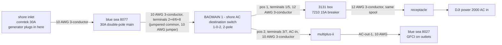
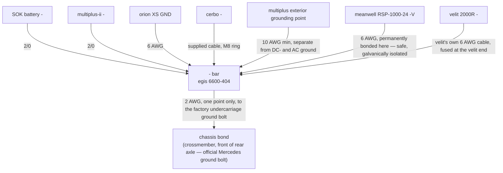
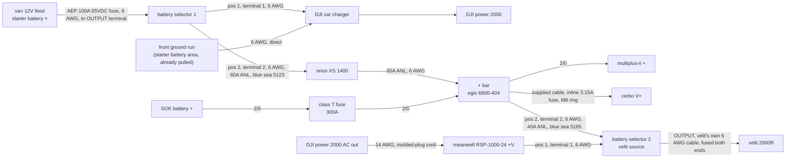
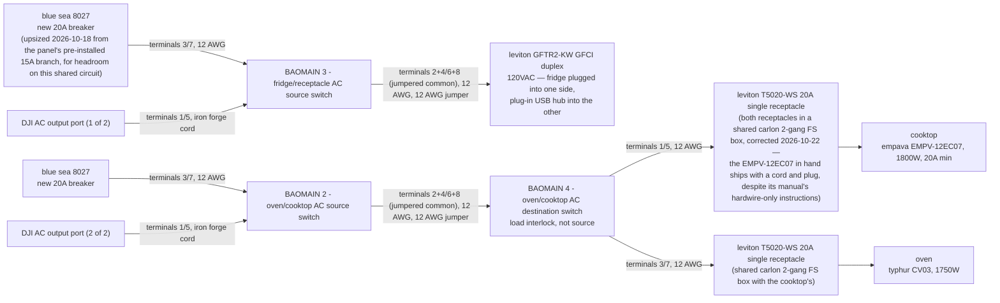
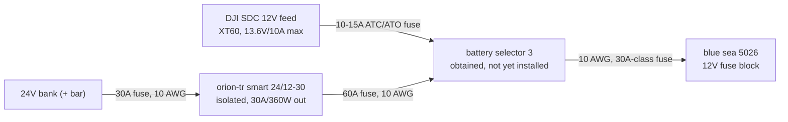
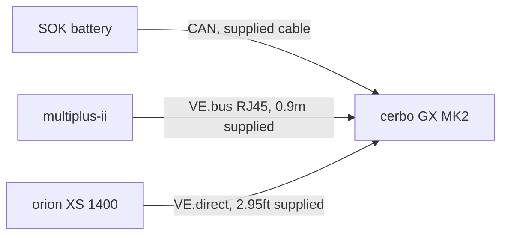

# electrical plan

last updated: 2026-10-03

one section per subsystem (matching the diagrams below), each leading with its diagram, then an installation checklist (ordered, check off as done), then a supplies checklist (`[x]` in hand, `[ ]` still needed). a returned item is removed from its supplies list entirely, not kept as a checked-off line. cable lengths and reel-sharing notes are inline on the relevant installation/supply line, not a separate table. open questions that anchor to one specific line are tagged inline as `(verify: ...)`; ones that don't are in "open questions" at the end. rejected or settled-either-way design alternatives are in "decided" at the end, so they don't get re-proposed. for the full history of how any of this got decided, `git log` is the change log — every change here has a commit message. for what's actually confirmed built, see README.md.

sections are ordered to match the real install sequence: ac input (wired, then held unenergized), then the DC backbone (negative before positive — that's the system's only ground reference and it goes in first, ending with the multiplus profile set and shore power plugged in), then the alternator (still part of dc positive and alternator), then back to ac input to finish (AC-out-1 to the 8027), then the kitchen AC loads and the velit (the back half of dc positive and alternator, concurrent with the kitchen) together, then the 12V bus, then data cables last. a few installation steps are flagged inline where this crosses section boundaries, since the sections themselves are grouped by diagram, not strictly by phase.

## tools required

- [x] DxCRIMP hex ferrule crimper, AWG 24-4
- [x] ferrule set, 166pc, AWG 1/0-12
- [x] [pro'skit 902-160 crimpro crimper](https://www.amazon.com/dp/B002PI6LU8), AWG 2-4-6 — for 6/4/2 AWG screw terminals
- [x] [IWISS battery cable lug crimping tool kit](https://www.amazon.com/IWISS-Battery-Crimping-Terminals-Stripper/dp/B09PYH9B4Q), AWG 8-4/0 — for the 2/0 ring lugs
- [ ] [adhesive-lined 3:1 heat shrink tubing kit, assorted sizes](https://www.amazon.com/270-pcs-Adhesive-Assortment-MILAPEAK/dp/B0771K1Z7Q) — covers the range of gauges used across this build (2/0 down to 12 AWG), unlike single-size kits
- [x] cable cutter
- [x] inch-pound torque wrench
- [x] commercial electric (mastech) MS8922H voltage tester — AC/DC voltage and GFCI test only, **no continuity/resistance function**, confirmed from its [manual](https://www.manualslib.com/manual/1483854/Mastech-Ms8922h.html) — not sufficient on its own for this plan's continuity checks
- [x] [woods DMMW3 pocket multimeter](https://www.woodshomeproducts.com/product/pocket-auto-range-multimeter/), 10-function, CAT III 300V, UL listed — has resistance/continuity/diode test, confirmed capable of every continuity check called for in this plan. [manual](https://manuals.plus/asin/B071D9KNMM)
- [ ] 1-1/8" hole saw — confirmed this is for the blue sea 3131's strain-relief cable-entry hole (not the breaker itself — the 7210 mounts on included screws with a knockout, no drilling needed there), per the 3131's own [installation instructions](https://defender.com/assets/pdf/blue-sea-systems/980014250.pdf)

## conventions

**switch position convention** (2026-09-21): position 1 is always the DJI leg, position 2 is always the victron leg, on every switch that splits between the two systems (BAOMAIN 1, BAOMAIN 2, BAOMAIN 3, battery selector 1, battery selector 2, battery selector 3). matches the physical layout — DJI mounted driver side/left, victron gear passenger side/right — so turning a switch left (position 1) selects DJI and right (position 2) selects victron. exception: BAOMAIN 4 selects between two *loads* (oven/cooktop), not two sources, so this convention doesn't apply to it — which appliance sits on which leg is arbitrary.

**BAOMAIN transfer-switch terminal wiring**: jumper terminal 2 to terminal 4 (common hot) and terminal 6 to terminal 8 (common neutral) to turn the switch's two independent contact pairs into one proper double-throw. terminal 1/5 is the "position 1" leg; terminal 3/7 is the "position 2" leg. ground never goes through the switch — bond all grounds together directly. terminal is a clamp/box terminal (screw with a square pressure washer, fully removable — not a stud, so ring terminals don't fit), accepts 2.5-6.0mm² wire (about 14-10 AWG), torque 1.2 N·m — confirmed against the switch's own manual (SZW26-32/40 row: M4 terminal screw, 2.5-6.0mm² wire range, 1.2 N·m tightening torque), matching the Ith:32A nameplate already confirmed, see [reference/baomain-operating-intructions.pdf](../reference/baomain-operating-intructions.pdf). confirmed by continuity meter on BAOMAIN 1 (2026-10-14): terminals 2/4 and 6/8 are genuinely separate contacts, not already bridged internally — the jumper is required, not optional. confirmed method: twist the incoming wire and the jumper together (or crimp into one ferrule sized for the box) and insert both into the terminal's clamp cavity together — seats securely, tested on BAOMAIN 1. each switch's specific terminal assignment is in its own category's installation checklist below.

**AC wiring is the dangerous part of this build — have it inspected before energizing anything past the inlet, especially the BAOMAIN switches.**

## ac input

### installation

- [x] mount the shore inlet, blue sea 8077, BAOMAIN 1, and the multiplus (shore power disconnected throughout)
- [x] wire inlet → 8077 → BAOMAIN 1 common, 10 AWG 3-conductor throughout (10ft max on the inlet-to-8077 leg — 15ft southwire SOOW cord on hand; confirmed for the 8077 itself, not just by analogy from the 8027: blue sea's own 8077 product page states that if the panel is more than 10ft from the shore power inlet, measured along the conductors, an additional fuse/breaker must be installed within that 10ft — [bluesea.com/products/8077](https://www.bluesea.com/products/8077/AC_Main_30A))
- [x] install BAOMAIN 1's jumpers (terminal 2→4 hot, 6→8 neutral), 10 AWG, twisted together with the incoming hot/neutral from the 8077 and seated together in each clamp terminal — confirmed solid, 2026-10-14
- [x] land BAOMAIN 1 pos 2 (terminal 3/7) → multiplus AC-in, 10 AWG 3-conductor, ferruled into its spring-loaded push-in terminals (L/N/PE) — confirmed seated securely, 2026-10-15. pos 1 (terminal 1/5) = 3131/DJI branch, wired later
- [x] continuity check: no hot-neutral or hot-neutral-ground continuity anywhere wired so far; confirmed position 2 connects it and position 0 opens it — 2026-10-15
- [x] **hold here** — do not plug in shore power yet. go wire the DC backbone (dc negative and ground, then dc positive and alternator below) first; that section ends with the multiplus profile set and shore power plugged in, then comes back to finish this list — resolved, shore power plugged in and confirmed working 2026-10-17 (see dc positive and alternator)
- [x] multiplus AC-out-1 → 8027, 10 AWG 3-conductor, landing on the 8027's 30A main — landed 2026-10-18, confirmed against [blue sea's own 8027 wiring diagram](../reference/bluesea8027-instructions.pdf) (p.2): hot → the 30A breaker's line-in terminal, neutral → the AC neutral bus, ground → the AC safety ground bus (confirmed physically labeled, two separate bars, left=ground/right=neutral on this panel). **multimeter verification confirmed, 2026-10-18** (hot-neutral, hot-ground, neutral-ground, reverse-polarity LED check) — passed the same day as landing, before work moved on to the 12V bus (exact readings not recorded)
- [ ] wire the DJI AC-input branch (deferred): BAOMAIN 1 pos 1 → 3131 box → 7210 15A breaker → receptacle → DJI AC in, 12 AWG 3-conductor (resolved: the 7210 is confirmed single-pole, 15A AC/DC — [bluesea.com/products/7210](https://www.bluesea.com/products/7210/A-Series_White_Toggle_Circuit_Breaker_-_Single_Pole_15A). the 3131 has no threaded gland — cable enters through 2 snap-in ratcheting strain reliefs sized by a 1-1/8" drilled hole (see tools above), and both the breaker and grounding connections require ring terminals, not bare wire under a screw — confirmed from the 3131's own [installation instructions](https://defender.com/assets/pdf/blue-sea-systems/980014250.pdf). still open: the marine/UL rating of the 12 AWG triplex on hand — labeled "marine grade" with no UL/ABYC rating given, brand unknown)
- [ ] continuity check on the DJI AC-input branch before energizing it

### supplies

- [x] victron multiplus-ii 24/3000/70, 120V, 3000VA — main inverter/charger
- [x] blue sea 8077, 30A double-pole main — shore/generator main breaker
- [x] conntek 30A 125V stainless shore inlet
- [x] carlon E987N-3-HD enclosure, 4x4x4in — houses the 8077. [home depot](https://www.homedepot.com/p/Carlon-4-in-x-4-in-x-4-in-Gray-Electrical-PVC-Junction-Box-E987N-3-HD-E987N-3-HD/100404095) (verify: fit against the real 8077, whose 2.63x3.75in footprint came from retailer listings, not an official blue sea manual)
- [x] southwire 10 AWG 3-conductor SOOW cord, 15ft — shore inlet to 8077. [lowe's](https://www.lowes.com/pd/Southwire-10-AWG-3-Black-Power-Cord-By-the-Foot/50148254)
- [x] BAOMAIN 32A cam changeover switch, SZW26-32/D202.2D — BAOMAIN 1, shore AC destination. [amazon](https://www.amazon.com/Baomain-Universal-Changeover-SZW26-32-D202-2D/dp/B09MMQPQQH)
- [x] blue sea 3131 circuit breaker enclosure — DJI AC-input branch
- [x] blue sea 7210, 15A toggle breaker — DJI AC-input branch
- [x] 12 AWG 12/3 triplex marine wire, 20ft — DJI AC-input branch
- [ ] [10 AWG triplex tinned marine wire, UL 1426](https://www.amazon.com/10-AWG-Triplex-Marine-Wire/dp/B06X6L6W2C) — 3 interior AC runs. picked over the plain "marine grade" wire already on hand for the kitchen circuits specifically because this one states a UL rating — the same open question flagged on the 12 AWG triplex below applies to any AC wire bought without checking for this
- [ ] [AMOMD weatherproof RV power outlet, 15A/20A, horizontal mount, 12/14 AWG push-on terminals](https://www.amazon.com/clp/B0DM1Q559K) — DJI AC-input branch, matches the 12 AWG triplex already on hand for this run
- [x] honda EU2200i generator, 1,800W — backup/shore AC source
- [x] jumper wire pair, 10 AWG — BAOMAIN 1's common. no separate purchase — cut from the already-owned southwire 10 AWG 3-conductor SOOW reel above, installed 2026-10-14 (see installation)

## dc negative and ground

### installation

- [x] mount the SOK — floor, passenger-side corner, parallel to the front wall, closest to the multiplus (a planned second SOK extends along the front wall toward the driver side) — mounted 2026-10-16
- [x] mount the positive and negative busbars tight against the SOK, passenger-side corner, same area as the multiplus and class T block — decided 2026-10-14, not left open: the high-current 2/0 connections (SOK, class T, multiplus) matter far more for being short than the meanwell's 6 AWG runs do for being shortened (under 1% voltage drop even stretched to 9ft). when the second SOK is added later (driver-side along the front wall), expect to replace SOK1's direct negative-bar cable with a SOK1→SOK2 jumper plus a new, longer SOK2→bar cable — SOK's own manual (parallel installation diagrams) taps the system's negative from whichever battery ends up *last* in the chain, not a fixed point, so this is a planned future rewire, not a sign the placement was wrong. both bars mounted and bolted down 2026-10-16
- [x] cut, crimp, pull-test, and heat-shrink the negative-side 2/0 cables — pacer 8ft black reel, both legs — confirmed pull-tested and heat-shrunk, 2026-10-16
- [x] wire the negative side first — this is the system's only ground reference, it goes in before anything else: SOK- → negative bar → multiplus-, 2/0 both legs — landed 2026-10-16
- [x] multiplus's separate exterior grounding point → negative bar — item F in Victron's Appendix A diagram, "primary ground connection M6 (PE)". upsized to 8 AWG (10 AWG called for, couldn't source it — fine, exceeds both the plan's spec and victron's own 4mm² minimum). landed 2026-10-16
- [x] single chassis bond off the negative bar → the official Mercedes M6 ground bolt at the crossmember in front of the rear axle (undercarriage), 2 AWG, pacer 10ft reel — routed and landed at both ends 2026-10-16 (busbar end: 2 AWG/3/8" lug sourced from west marine; ground-bolt end: seafit "#2-1/4" lug), replacing the originally-planned ceiling stud, which turned out not to be one of Mercedes' approved upfitter ground points at all. [reference/factory-chasis-ground.png](../reference/factory-chasis-ground.png) (Mercedes upfitter manual, §8.4.12): torque for M6 is **8 N·m ± 0.8 N·m** (about 64-78 in-lb — not the 120-140 in-lb figure used elsewhere in this build, which is sized for 3/8"/M8 hardware); maintain at least 3 full thread turns of protrusion; max 4 cable lug connections per bolt, radially distributed if more than one — not a concern here with a single lug
- [x] torque every negative-side stud just landed (egis busbar 120-140 in-lb; SOK terminals 9-11 N·m; chassis bond M6 ground bolt 8 N·m ± 0.8 N·m — three different torques, don't reuse settings between them) — 2026-10-16

### supplies

- [x] [egis powerbar 6600-404](https://www.westmarine.com/egis-mobile-electric-powerbar---four-m103-8inch-studs-4-circuits-8---600-amp-21976824.html) — negative busbar, replaces the 6600-804
- [x] pacer marine tinned copper battery cable, 15ft #6 black — negative-side runs
- [x] pacer marine tinned copper battery cable, 10ft #2 black — chassis bond
- [x] pacer marine tinned copper battery cable, 8ft #2/0 black — negative 2/0 runs
- [x] [seafit "#2-1/4" lug 5-pack](https://www.westmarine.com/seafit-heavy-duty-tinned-lugs-22320485.html) — chassis bond, ground-bolt end (1 needed, 4 spare)
- [x] 2 AWG, 3/8" hole lug — chassis bond, negative-bar end, sourced from west marine 2026-10-16
- [x] [pacer marine tinned copper primary wire, 8 AWG black, 25ft spool](https://www.westmarine.com/pacer-marine-tinned-copper-primary-wire-P021453725.html?dwvar_P021453725_variant_filter_2=100%27%20Spool&dwvar_P021453725_variant_filter_1=Black&dwvar_P021453725_variant_filter_3=8%20AWG) — multiplus exterior grounding point to negative bar (upsized from the originally-called-for 10 AWG, 2026-10-16 — see installation above)
- [x] [seafit "#8-#10" lug 5-pack](https://www.westmarine.com/seafit-heavy-duty-tinned-lugs-22320220.html) — multiplus's exterior grounding point end (M6 per Victron's own spec; already landed 2026-10-16, see installation above)
- [x] [seafit "#8-3/8" lug 5-pack](https://www.westmarine.com/seafit-heavy-duty-tinned-lugs-22320246.html) — negative bar end, matches the bar's 3/8" studs
- [ ] 2/0 lug, M8 hole, x2 — SOK-, multiplus- (plan: drill from seafit "#2/0-5/16" lugs, see dc positive and alternator)
- [ ] 2/0 lug, 3/8" hole, x2 — SOK-→-bar and -bar→multiplus- busbar ends (shares the seafit "#2/0-3/8" 5-pack tracked under dc positive and alternator)
- [x] (covered by the "#6-3/8" lug 5-packs tracked under dc positive and alternator for its XS-GND and meanwell−V ends)

## dc positive and alternator

### installation

- [x] continuity check: no continuity between the + and - bars — run 2026-10-16. result needs a caveat, not a flat pass/fail: bar-to-bar reads diode-like (continuity one polarity, open the other) with the multiplus connected — confirmed, by temporarily disconnecting multiplus- and re-testing (clean open both directions with it isolated), that this comes from the multiplus's own internal DC-input protection circuitry, not a wiring fault. the class T fuse isn't inserted yet, so SOK+ has no path to the positive bar at all right now and was never a factor. expect this same asymmetric reading on future bar-to-bar checks as long as the multiplus is connected — it's normal, not a regression
- [x] mount the class T fuse block near the busbars (fuse not inserted yet) — in place 2026-10-16
- [x] cut, crimp, pull-test, and heat-shrink the positive-side 2/0 cables — pacer 8ft red reel, all three legs — confirmed pull-tested and heat-shrunk, 2026-10-16
- [x] wire the positive side: SOK+ → class T fuse block → positive bar → multiplus+, 2/0 throughout — landed 2026-10-16, fuse itself correctly not yet inserted
- [x] torque every positive-side stud just landed (egis busbar 120-140 in-lb; class T block 190 in-lb max; SOK terminals 9-11 N·m) — 2026-10-16
- [x] install the class T fuse last; turn on the SOK (a small spark on connection is normal) — fuse installed and SOK powered on cleanly 2026-10-16 (RUN flashing per standby mode, ALM off, no faults)
- [x] set the multiplus's battery profile to lithium, absorption ≤27.6V — resolved 2026-10-17 via the MK3-USB-C interface (ordered after the cerbo/Remote Console path turned out not to expose this setting, see git history for that detour) connected straight into the multiplus's second VE.Bus port, computer running VictronConnect. lithium mode was already enabled; absorption changed from the 28.80V default to **27.60V**, float changed from 27.60V to **26.40V**, matching the figures worked out earlier (float derived from victron's own default 24V absorption/float/storage step pattern, applied to this build's lower absorption cap). charge current left at the 70A default — comfortably under the SOK's rated limits, no reason to change it. **remaining open item, same DVCC caveat as before**: SOK is not on victron's official Pylontech compatibility list (that list names real Pylontech models only — UP2500/US2000/US3000/etc.) — but SOK's BMS emulates the Pylontech CAN protocol closely enough that DIY users report the cerbo correctly auto-detecting it as a "Pylontech" device and running DVCC successfully, per multiple [DIY Solar Forum](https://diysolarforum.com/threads/sok-48v-100ah-victron-communication.120343/) and [Victron Community](https://community.victronenergy.com/t/pylontech-battery-cerbo-gx-pylontech/59161) threads — functional, not officially supported. before enabling DVCC, confirm this SOK unit auto-detects correctly (see the data cables section's detection check) rather than assuming compatibility from these reports alone
- [x] plug in shore power; verify with a multimeter (120V hot-neutral, 120V hot-ground, 0V neutral-ground); confirm the reverse-polarity LED is off before energizing any branch circuit — **first live energization, 2026-10-17**: reverse-polarity LED confirmed off before closing the 8077's main breaker. multimeter readings: hot-neutral ~112V, hot-ground ~112V, neutral-ground <1V — the two hot-referenced readings matching confirms correct wiring (no cross-fault), and the ~112V (vs nominal 120V) is voltage drop from the residential extension-cord source under load, not a van wiring issue; well within the multiplus's own 90-140V input range regardless. multiplus picked up the connection immediately and entered bulk charging (solid yellow "Bulk" LED, matching its documented indicator table) — first confirmation the lithium profile set the previous step is actually working. continue with the alternator steps below next — ac input's AC-out-1-to-8027 step comes after those, not before
- [x] pull the AEP fuse on the van feed (or disconnect the starter battery terminal) before touching any alternator wiring — the short segment between battery and fuse holder stays live even with the fuse pulled (this area shares the under-seat cavity with an existing audiocontrol LE5-1300 amplifier — route new DC cables clear of its wiring) — pulled 2026-10-16
- [x] mount battery selector 1
- [x] mount the orion XS — 2026-10-16
- [x] land the van feed (already run) on selector 1's "OUTPUT" terminal, M10 stud (as installed, under 15ft, confirmed marked 6 AWG; selector end is M10 — the "5/16"" lug size recorded for this run elsewhere was stale, left over from before the M10 correction) — 2026-10-16
- [x] selector 1 terminal "2" → XS IN, 6 AWG (position 2, victron leg; pacer 15ft red reel, shared across all 4 red 6 AWG runs in this section — this leg is under 6ft, under-bed run; XS's own terminal is a screw type, no lug) — landed 2026-10-17
- [ ] **add a dedicated 60A ANL fuse on this leg, close to selector 1's terminal "2"** — reverses the earlier "no separate input-side fuse" decision, 2026-10-18: the van feed's 100A AEP fuse upstream is correctly sized for the DJI charger leg (DJI's own documentation calls for up to 70A draw with a 100A fuse) but is genuinely mismatched for this 6 AWG XS leg — the orion XS's own cable/fuse table recommends 60-70A for 6AWG, not 100A. since selector 1's two legs have different real current needs, one shared upstream fuse can't correctly protect both; each leg needs its own match. same part as the XS output fuse (blue sea 5123, 60A) — see supplies
- [ ] leave terminal "1" unconnected for now (DJI charger leg, deferred) — **no separate fuse needed here when it's eventually wired**: the van feed's existing 100A AEP fuse already matches DJI's own documented requirement for their charger (up to 70A draw, 100A fuse per DJI's own spec) — considered and rejected adding a redundant fuse here, 2026-10-18, since it would duplicate the same protection already in place with no added safety margin, and a lower value (e.g. 70A, right at the charger's rated max with no headroom) would actually risk nuisance tripping during normal full-power charging
- [x] XS OUT → 6 AWG → 60A ANL (5123) → positive bar (same 15ft red reel, under 6ft) — cable run and ANL block in place 2026-10-17. **fuse element itself not yet sourced/seated** (blue sea 5123, 60A — still unchecked in supplies below) — this leg is not yet protected; don't energize the XS output until it's in
- [x] XS GND → 6 AWG → negative bar (pacer 15ft black reel, shared with meanwell -V below, under 6ft) — landed 2026-10-17. **not the same ground as the DJI charger's, see below**; the orion XS's output lands on the SOK's own positive bar, so its return has to close the loop at the SOK's negative bar specifically, not chassis or any other ground point
- [x] front ground run (already pulled from the starter battery area to the switch box, 6 AWG) lands directly on the **DJI car charger's own ground terminal** — decided 2026-10-16, replacing an earlier plan to cap it off unused. the DJI charger's output goes to DJI power 2000, a completely separate system from the SOK, so its return belongs there, not on the SOK's negative bar — landing it on the SOK bus instead would bridge two systems this build otherwise keeps independent except through the selector switches themselves. the two chargers now share only the common + feed through selector 1; each keeps its own separate ground
- [x] continuity check with selector 1 OFF: confirm position 2 connects OUTPUT to "2" and nothing else, before reinserting the fuse — confirmed 2026-10-17: OUTPUT-to-"2" open, OUTPUT-to-"1" open, XS IN-to-negative-bar open — all clean with the selector off, as expected
- [ ] reinsert the AEP fuse; switch selector 1 to position 2
- [ ] configure the XS via VictronConnect: lithium profile, absorption ≤27.6V, input current limit ~60A (verify: the alternator is rated 180A or 220A depending on build variant, printed on its own back cover — either option clears this 60A setting with headroom, but worth a physical check for certainty), engine-running detection on

the alternator branch above is done. the rest of this section (velit, below) happens alongside ac loads — not immediately next — since both are the same later phase of work; do ac input's AC-out-1-to-8027 step first if it isn't done yet.

- [ ] DJI AC out → meanwell AC input: molded-plug cord, 14 AWG minimum (no separate breaker needed — DJI's own output protection plus the meanwell's internal AC-input protection cover it; meanwell mounts driver-side wall, near the DJI, making this tap short)
- [x] mount battery selector 2 near the DC busbars (both battery selectors are already mounted, in the switch row, far passenger end, directly above the SOK)
- [ ] meanwell +V output → selector 2 terminal "1" (position 1, DJI leg), 6 AWG (pacer 15ft red reel, same as above — **this leg is longer than the rest of this reel's runs**: the meanwell is driver-side near the DJI, selector 2 is passenger-side above the SOK, so this crosses most of the 5.5ft front wall plus the height change — realistically 6-9ft, not under 6ft; measure before cutting)
- [ ] + bar → 40A ANL (blue sea 5165) → selector 2 terminal "2" (position 2, victron leg), 6 AWG (same reel — this leg is confirmed short, selector 2 sits directly above the SOK/busbars)
- [ ] meanwell -V output → negative bar, 6 AWG (pacer 15ft black reel, same as XS GND — **also longer than assumed**, same driver-to-passenger crossing as the meanwell +V leg above, realistically 6-9ft; measure before cutting)
- [ ] selector 2 OUTPUT → velit: velit's own supplied 6 AWG cable, already fused both ends; confirm the meanwell's output is set within its 20-26.4V range first
- [ ] continuity check with selector 2 OFF: no continuity anywhere; position 1 connects OUTPUT to the meanwell leg only, position 2 to the direct bus tap only; confirm the meanwell -V and velit cable negative both read continuous to the negative bar regardless of position
- [ ] selector 1 pos 1 → DJI charger leg (deferred)

### supplies

- [x] SOK SK24V150PH, 24V 150Ah, 3.84kWh — main battery bank
- [x] victron orion XS 1400, 1-50A adjustable — alternator DC-DC charger
- [x] battery selector switch, 300A off-1-2 — selector 1, van feed to XS/DJI charger
- [x] battery selector switch, 300A off-1-2 — selector 2, velit source
- [x] egis powerbar 6600-404, 4-stud — positive busbar. [west marine](https://www.westmarine.com/egis-mobile-electric-powerbar---four-m103-8inch-studs-4-circuits-8---600-amp-21976824.html)
- [x] egis mobile electric 3912B class T fuse block, M8 studs — battery main fuse holder. [west marine](https://www.westmarine.com/egis-mobile-electric-class-t-fuse-block-225---400-a-sealed-21481650.html)
- [x] eaton/bussmann JJN-300 limitron class T fuse, 300A — battery main fuse. [west marine](https://www.westmarine.com/eaton-limitron-fast-acting-class-t-fuse-22185755.html)
- [x] 2x blue sea 5005 ANL fuse block, 5/16" studs — XS output fuse, velit direct-DC tap fuse
- [ ] blue sea 5005 ANL fuse block, 5/16" studs — XS **input** fuse — **ordered from amazon 2026-10-18**, not yet in hand
- [ ] [blue sea 5123, 60A ANL fuse](https://www.amazon.com/Blue-Sea-Systems-5123-Fuse/dp/B06XFFKD67) — XS output
- [ ] [blue sea 5123, 60A ANL fuse](https://www.amazon.com/Blue-Sea-Systems-5123-Fuse/dp/B06XFFKD67) — XS input, added 2026-10-18 (2nd one, same part as output — need 2 total)
- [ ] [blue sea 5165, 40A ANL fuse](https://www.amazon.com/Blue-Sea-5165-40A-Fuse/dp/B008GLEMMW) — velit direct-DC tap
- [x] pacer marine tinned copper battery cable, 15ft #6 red — selector/XS/busbar positive runs
- [x] pacer marine tinned copper battery cable, 8ft #2/0 red — positive 2/0 runs
- [x] meanwell RSP-1000-24 — AC-to-24VDC supply for the velit, DJI leg
- [x] velit 2000R rooftop AC, 24V DC, 720W — rooftop air conditioner
- [ ] [iron forge 12/3 SJTW molded-plug cord, 15ft](https://www.amazon.com/Replacement-Supply-Extension-Universal-Appliance/dp/B0C5KHWHMT) — DJI AC output to meanwell, a third of the same cord already used for the two kitchen taps below (likely needs the longer ~15ft length, not 6ft: the DJI-to-switch-row distance is estimated 8-10ft by the cargo-area geometry, not tape-measured)
- [x] DJI power 2000 + expansion battery 2000 — secondary AC/DC power system
- [x] DJI super fast charger (DYS_DC1000) — alternator-to-DJI charger
- [x] seafit "#6-5/16" lug 5-pack — ANL block 6 AWG ends (XS output, velit tap)
- [x] 2x [seafit "#6-3/8" lug 5-pack](https://www.westmarine.com/seafit-heavy-duty-tinned-lugs-22320329.html) — busbar and selector 6 AWG ends (10 lugs covers all 9 ends, shared with dc negative and ground, 1 spare)
- [ ] 2x [seafit "#2/0-5/16" lug 5-pack](https://www.westmarine.com/seafit-heavy-duty-tinned-lugs-22320667.html) — 6 M8-hole ends total (SOK+/-, multiplus+/-, both class T block ends), drilled from 5/16" to M8 (10 lugs covers 6 needed with 4 spare for a future second SOK)
- [ ] 1x [seafit "#2/0-3/8" lug 5-pack](https://www.westmarine.com/seafit-heavy-duty-tinned-lugs-22320659.html) — 4 3/8"-hole busbar ends total (block→+bar, +bar→multiplus+, SOK-→-bar, -bar→multiplus-), no modification needed (5 lugs covers 4 needed with 1 spare)

## ac loads

### installation

- [x] mount BAOMAIN 3 and BAOMAIN 2 (BAOMAIN 4 not yet mounted — it goes in the kitchen cabinet, see below)
- [x] upsized the fridge+USB circuit from 15A to 20A, 2026-10-18 — a deliberate ceiling increase for headroom on this shared branch, not driven by the actual loads (fridge + USB outlet together are nowhere near 15A). wire from the kitchen to the rear already pulled for both kitchen circuits, 12 AWG
- [x] install a new 20A breaker in one of the 8027's open positions (not the panel's pre-installed 15A branch position, which this circuit no longer uses — that position is now free for something else, e.g. the still-undesigned water heater circuit) → BAOMAIN 3 terminal 3/7, 12 AWG (position 2) — landed 2026-10-22
- [x] install BAOMAIN 3's jumpers (terminal 2→4, 6→8), 12 AWG. pos 1 (terminal 1/5) = DJI AC output port, deferred. pos 2 (terminal 3/7) = 8027's new 20A breaker. common = the 20A fridge+USB circuit — landed 2026-10-22
- [x] BAOMAIN 3 common → leviton GFTR2-KW GFCI duplex, 12 AWG, landing on its **LINE** terminals (not LOAD — this is the only outlet on this run, LOAD is for daisy-chaining downstream outlets) — landed 2026-10-22
- [x] continuity check, fridge/USB branch (BAOMAIN 3), before energizing: position 0 open hot-neutral/hot-ground/neutral-ground; position 2 continuous breaker-to-duplex on both hot and neutral with no shorts; position 1 open (DJI tap still deferred) — passed 2026-10-22
- [x] live verification, fridge/USB branch: multiplus switched on (inverting off the SOK bank, no shore power connected — confirmed AC-out-1 passes through on multiplus state alone, so this validated the battery-inverter path specifically), 8027's new 20A breaker closed, BAOMAIN 3 to position 2 — hot-neutral ≈120V, hot-ground ≈120V, neutral-ground ≈0V, reverse-polarity LED off, GFCI test/reset confirmed working — passed 2026-10-22. **note for the oven/cooktop branch later**: shore power, if connected, passes through AC-out-1 regardless of the multiplus's on/off state — don't assume the multiplus being off means this panel is dead
- [ ] install a new 20A breaker in one of the 8027's open positions → BAOMAIN 2 terminal 3/7, 12 AWG (position 2)
- [ ] install BAOMAIN 2's jumpers, 12 AWG. pos 1 (terminal 1/5) = DJI AC output port, deferred. pos 2 (terminal 3/7) = 8027's new 20A breaker. common = feeds BAOMAIN 4's common
- [ ] mount BAOMAIN 4 and install its jumpers, 12 AWG. common = BAOMAIN 2's output. pos 1 (terminal 1/5) = cooktop's receptacle. pos 2 (terminal 3/7) = oven's receptacle (swapped from the original oven-pos1/cooktop-pos2 assignment, 2026-10-22, per preference — arbitrary either way, see the switch position convention note above) (BAOMAIN 4 mounts in the kitchen cabinet, ~4ft forward of the cargo area's front wall — outside the cargo area entirely)
- [ ] mount the carlon E9802E-5-HD 2-gang FS box in the kitchen cabinet near BAOMAIN 4; install both leviton T5020-WS single receptacles into it — one for the oven, one for the cooktop (corrected 2026-10-22: the cooktop was originally planned as hardwired direct, no receptacle, per its manual's own "requires hardwiring by a qualified technician — no plug" instruction, but the actual EMPV-12EC07 unit in hand ships with a cord and plug — going with the physical part in hand over the manual's generic text)
- [ ] BAOMAIN 2 common → BAOMAIN 4 common, 12 AWG
- [x] BAOMAIN 4 terminal 1/5 → cooktop's receptacle, 12 AWG — landed 2026-10-22
- [ ] BAOMAIN 4 terminal 3/7 → oven's receptacle, 12 AWG — **on hold, 2026-10-22: out of 12 AWG wire for this leg**, need more before finishing
- [ ] leave BAOMAIN 3 and BAOMAIN 2 terminal 1/5 unconnected (DJI AC-output-port taps, deferred)
- [ ] continuity check, oven/cooktop branch (BAOMAIN 2/4): no continuity hot-neutral or either to ground; confirm BAOMAIN 4 position 1 energizes only the cooktop's receptacle and position 2 only the oven's receptacle, never both
- [ ] 8027 backlight board → its own fused (1.0-2.0A) DC feed and ground, separate from everything in the AC schedule above (likely fine at 24V: the 8027's own instructions don't state a voltage, but blue sea's standalone backlight systems for other panels are rated 12-24V DC nominal, 32V DC max — [bluesea.com/products/8383](https://www.bluesea.com/products/8383/Backlight_System_13_pos_12-24V) — not a confirmed match to the 8027's specific built-in board, so still worth a multimeter check before connecting; source of the DC feed not yet picked)
- [x] confirmed 2026-10-18: the panel's 3 originally pre-installed 15A branches are now all free — the fridge/USB circuit moved off its 15A branch to a new 20A position, and the other 2 pre-installed 15A branches were never used. a real candidate for the still-undesigned water heater circuit (TBD throughout this file and README.md), once its actual wattage is known

**AC wiring is the dangerous part of this build — have it inspected before energizing.**

### supplies

- [x] blue sea 8027, main + 6, 30A main — AC branch panel
- [x] carlon E989N-CAR enclosure, 8x8x4in — houses the 8027. [home depot](https://www.homedepot.com/p/Carlon-8-in-x-8-in-x-4-in-Gray-Electrical-PVC-Junction-Box-E989N-CAR-E989N-CAR/100404099)
- [x] [BAOMAIN 32A cam changeover switch](https://www.amazon.com/Baomain-Universal-Changeover-SZW26-32-D202-2D/dp/B09MMQPQQH) — BAOMAIN 3, fridge/receptacle AC source
- [x] [BAOMAIN 32A cam changeover switch](https://www.amazon.com/Baomain-Universal-Changeover-SZW26-32-D202-2D/dp/B09MMQPQQH) — BAOMAIN 2, oven/cooktop AC source
- [x] [BAOMAIN 32A cam changeover switch](https://www.amazon.com/Baomain-Universal-Changeover-SZW26-32-D202-2D/dp/B09MMQPQQH) — BAOMAIN 4, oven/cooktop AC destination
- [x] 2x blue sea 7214, 20A toggle breaker — 1 for the oven/cooktop circuit, 1 (the former spare) now used for the upsized fridge+USB circuit, 2026-10-18 — no spare remains
- [x] 12 AWG 12/3 triplex marine wire, 20ft — oven/cooktop circuit (verify: marine/UL rating — labeled "marine grade" with no UL/ABYC rating given)
- [ ] more 12 AWG wire — ran out partway through the BAOMAIN 4-to-oven-receptacle leg, 2026-10-22 (work paused here). same open UL-rating question as the spool above applies to whatever's bought; consider the [UL 1426-rated triplex](https://www.amazon.com/10-AWG-Triplex-Marine-Wire/dp/B06X6L6W2C) sourced earlier for the interior AC runs, in 12 AWG if available, to actually close that question instead of extending it
- [x] 12 AWG 12/3 triplex marine wire — fridge+USB circuit, upsized from 14 AWG 2026-10-18, confirmed 3-conductor triplex matching the oven/cooktop circuit's wire type. pulled from the kitchen to the rear of the vehicle for both kitchen circuits
- [x] [iron forge 12/3 SJTW molded-plug cord, 15ft](https://www.amazon.com/clp/B0C5KHWHMT) — DJI AC-output tap, fridge/USB leg
- [x] [iron forge 12/3 SJTW molded-plug cord, 6ft](https://www.amazon.com/clp/B0B8DPVW57) — DJI AC-output tap, oven/cooktop leg
- [x] typhur CV03 sync oven, 1750W — kitchen oven
- [x] empava EMPV-12EC07 induction cooktop, 1800W — kitchen cooktop. corrected 2026-10-22: planned as hardwired per the manual, but the unit in hand ships with a cord and plug — now receptacle-fed like the oven
- [x] deaprull D31A fridge, 35-45W, 120VAC — kitchen fridge
- [x] [leviton GFTR2-KW 20A/125V GFCI duplex receptacle](https://www.homedepot.com/p/Leviton-20-Amp-125-Volt-Duplex-SmarTest-Self-Test-SmartlockPro-Tamper-Resistant-GFCI-Outlet-White-GFTR2-KW-R92-GFTR2-0KW/205999867) — fridge + USB circuit, 2026-10-18. one duplex outlet serves both: fridge plugs into one side, a plug-in USB hub/outlet (not a dedicated wall receptacle) into the other — resolves the separate "USB charging outlet" line below, no dedicated USB wall outlet needed
- [ ] plug-in USB hub/outlet, e.g. [this one](https://www.amazon.com/dp/B0FBWCR2Y7) — plugs into the GFCI duplex's second socket, not hardwired
- [x] 2x [leviton T5020-WS 20A/125V single tamper-resistant receptacle](https://www.homedepot.com/p/Leviton-20-Amp-125-V-Tamper-Resistant-Single-Outlet-Receptacle-White-1-Pack-T5020-WS-R52-T5020-0WS/202066676) — one for the oven, one for the cooktop, 2026-10-22. replaces the earlier CR020-W duplex plan: separate single receptacles instead, for a clean split between the two appliances coming out of BAOMAIN 4
- [x] [carlon E9802E-5-HD 2-gang FS box](https://www.homedepot.com/p/Carlon-2-Gang-32-cu-in-3-4-in-Electrical-PVC-Type-FSE-FS-Box-E9802E-5-HD-E9802E-5-HD/100404110) — houses both T5020-WS receptacles
- [ ] [blue sea 3102100, A-series ELCI/GFCI double-pole 120V 30A breaker](https://www.amazon.com/Blue-Sea-Systems-3102100-Circuit/dp/B00H2BY3FI) — 8027 AC-out-1, matches the 30A main breaker position's rating
- [x] jumper wire pair, 12 AWG — BAOMAIN 3's common (upsized from 14 AWG 2026-10-18). no separate purchase — cut from the already-owned 12 AWG 12/3 triplex reels above
- [x] jumper wire pair, 12 AWG — BAOMAIN 2's common. no separate purchase — cut from the already-owned 12 AWG 12/3 triplex reels above
- [x] jumper wire pair, 12 AWG — BAOMAIN 4's common. no separate purchase — cut from the already-owned 12 AWG 12/3 triplex reels above

## 12V bus

### installation

- [ ] confirm the fuse holder on hand is the right format (10-15A ATC/ATO inline, not ANL — ANL fuses aren't made that small)
- [ ] DJI SDC feed → 5026 main input, through the fuse; DJI SDC negative → 5026 negative bus (wires only the DJI leg for now)
- [ ] wire the USB panel branches, 10A ATC fuse each
- [ ] hold the LED puck and starlink branches until their actual watts are known — don't guess a fuse size
- [ ] voltage check: confirm the 5026 reads close to 13.6V at a populated branch position
- [ ] once selector 3 and the orion-tr converter are installed: insert selector 3 between the DJI SDC feed and the 5026 main input; wire the orion-tr's 24V input and 12V output; upsize the main-input fuse to 30A-class to match the new victron leg. real specs now confirmed from [the orion-tr's own manual](../reference/34439-Orion-Tr_Smart_DC-DC_Charger-pdf-en.pdf) (added 2026-10-18, replacing earlier reasoned estimates): 24V input side — 30A fuse, 10 AWG (per the manual's own fuse/cable table, p.5, at ~1m run length; measure actual distance before cutting, per convention); 12V output side — 60A fuse, 10 AWG at ~1m (this model's continuous output is 30A/45A burst, and 60A matches Victron's calibrated figure for this current class in the same product family, not an arbitrary oversized number — deferred to their own table rather than a smaller derived estimate). DC connection is screw terminals, torque **1.6 Nm**, max cable size 6AWG (this build's 10AWG is well within that). **ships with a remote on/off wire loop pre-installed (always-on when powered)** — leave as-is, since battery selector 3 is this leg's actual on/off control. **not reverse-polarity protected — damage from reverse polarity voids warranty and cannot be repaired; verify polarity carefully before connecting.** engine shutdown detection (the manual's section 5) does not apply to this installation — that feature is for alternator/starter-battery inputs, not relevant since this unit's input here is the 24V house bank

### supplies

- [x] blue sea 5026, 12-circuit fuse block — 12V bus (LED pucks, USB panels, starlink)
- [x] victron orion-tr smart 24/12-30 isolated, 30A/360W — 5026 bus's victron-leg converter. [amazon](https://www.amazon.com/dp/B086R9ZVK5)
- [x] [battery selector switch, 300A off-1-2](https://www.amazon.com/dp/B0C85R2VD2) — selector 3, 5026 bus source
- [ ] [blue sea 5065, waterproof in-line ATO/ATC fuse holder](https://www.amazon.com/Blue-Sea-Systems-Waterproof-Holder/dp/B004ZIUA62) (12 AWG pigtails, 30A max holder rating — fuse itself sold separately) + 10-15A ATC fuse — DJI SDC to 5026 feed (verify: confirm the fuse states a real AIC rating when bought — ABYC E-11 table V isn't freely published and doesn't apply cleanly here anyway, since this feed's actual source is DJI's own 10A-current-limited, BMS-protected battery, not a raw bank; standard ATC/ATO fuses, typically 1000-6000A AIC at 32V, are almost certainly adequate)
- [ ] blue sea 5026 branch fuses, 4x 10A ATC — USB panels
- [ ] 10 AWG lug, 3/8" hole, x3 — selector 3 connections
- [ ] blue sea 5005 ANL fuse block + 35A ANL fuse (5164, nearest standard size above the manual's 30A spec) — orion-tr 24V input side (bank to converter). block **ordered from amazon 2026-10-18**, not yet in hand; fuse itself still needs sourcing (generic ANL fuses, car-audio section at AutoZone/O'Reilly/Walmart, fit the same block — verify a stated AIC rating if not Blue Sea branded)
- [ ] blue sea 5005 ANL fuse block + 60A ANL fuse (5123) — orion-tr 12V output side (converter to selector 3). block **ordered from amazon 2026-10-18**, not yet in hand; fuse itself still needs sourcing
- [ ] 10 AWG cable — orion-tr input and output legs, both sides (confirm actual run lengths before cutting; 10 AWG covers both at ~1m per the manual's own table, see installation above)

## data cables

### installation

- [x] cerbo power (Power in V+) → + and - bars, supplied cable with an inline 3.15A slow-blow fuse already built in — pulled forward early, 2026-10-16, to unblock configuring the multiplus without needing an MK3-USB (see "dc positive and alternator" above and "set the multiplus's battery profile" there). the M8 ring eyes fit the 3/8" bar studs fine, despite the size mismatch flagged earlier — confirmed by direct test, not worth re-terminating
- [ ] dedicate one of the cerbo's 2 VE.Can ports to the SOK; set the port profile to BMS-Can (500kbit/s); terminate with one of the 2 included VE.Can terminators
- [ ] SOK → cerbo, CAN, SOK's own supplied cable
- [x] multiplus → cerbo, VE.bus RJ45, 0.9m supplied — pulled forward early, 2026-10-16, same reason as above
- [x] orion XS → cerbo, VE.direct, 2.95ft supplied — landed 2026-10-17 (pulled forward early, alongside the multiplus VE.Bus and cerbo power connections already done; the XS itself isn't powered yet, still waiting on its output-side 60A ANL fuse)
- [ ] power the cerbo only from "Power in V+" (8-70VDC) — never from a multiplus AC-out
- [ ] turn DVCC on
- [ ] confirm the SOK auto-detects as a "Pylontech" device in the cerbo's device list

### supplies

- [x] victron cerbo GX MK2 (PN BPP900450110) — system monitor, CAN/DVCC hub. ships with its own power cable (inline 3.15A fuse, M8 rings) — powered early from the busbars and VE.Bus-connected to the multiplus (both landed 2026-10-16), originally to try configuring the multiplus without an MK3-USB — turned out not to work (see "dc positive and alternator" above), but both connections are needed for this section anyway, nothing wasted
- [x] [victron interface MK3-USB-C (VE.Bus to USB-C)](https://www.amazon.com/gp/product/B0BNBVKSTH) — used to set the multiplus's lithium battery profile via VictronConnect on a mac, 2026-10-17. uses a standard straight-through RJ45 patch cable (confirmed, not a proprietary Victron pinout) — borrowed the cerbo's cable for this since a dedicated second one wasn't on hand
- [x] victron VE.direct cable, 2.95ft — orion XS to cerbo
- [x] victron RJ45 UTP cable, 0.9m — multiplus to cerbo

## open questions

items that don't anchor to one specific installation step. everything else is tagged inline as `(verify: ...)` on the relevant line above.

- confirm the physical left-to-right order of the switch row once it's documented — 8077, BAOMAIN 1, BAOMAIN 3, and BAOMAIN 2 are mounted, but which order they ended up in wasn't recorded
- velit refrigerant charge amount: confirmed contradiction, both figures straight from the manual — spec table (p.4) says 500g R32a for the 24V variant, troubleshooting section 5.2 (p.12) says 410g for 24V — [reference/Velit_2000R_User_Manual_2609.pdf](../reference/Velit_2000R_User_Manual_2609.pdf). not resolvable from the document alone; contact velit support (support@velitcamping.com, per the manual's own intro page) for the real figure before any refrigerant service rather than trusting either number
- water heater wattage (ecosmart eco mini 4): resolved without needing to buy it — manufacturer spec is 1440W / 12A / 120V, confirmed at [ecosmartus.com](https://www.ecosmartus.com/product/ecosmart-eco-mini-4-gallon-tank). 12A continuous is right at 80% of a 15A breaker (NEC's continuous-load derate threshold) — worth a 20A branch instead of reusing one of the freed 15A positions, same reasoning as the fridge+USB circuit's upsize. added to README.md's load budget; circuit source/breaker/receptacle still TBD

## decided

settled questions and rejected alternatives, kept here so they don't get re-proposed. the live design above is the current answer; this is why.

- no ATS, no smartshunt — manual switches and the SOK's own CAN-based state-of-charge reporting cover this instead
- orion XS 1400 is the alternator DC-DC charger — not the orion-tr smart 12/24-15, which was returned (a different orion-tr model, the smart 24/12-30, is the unrelated 12V-bus converter above)
- no second generator inlet — the generator plugs into the shore inlet
- SOK charged at ≤27.6V absorption, slightly below its own 28V spec — a deliberate margin, not a bug
- velit: a pure direct-DC-only feed (skipping the DJI leg entirely) was not adopted, since it would drop the velit off the dual-source pattern every other major load follows. the hybrid design above (selector 2: direct 24V tap or DJI-fed meanwell) was adopted instead, recovering about 17% round-trip conversion loss on the battery leg while keeping both sources
- BAOMAIN 1 kept as the shore AC destination switch rather than replaced with a direct multiplus feed plus a separate DJI breaker — that would lose the interlock (nothing would stop both systems drawing from shore at once) and the neutral isolation
- no separate 4 AWG/80A ANL (5124) run for the XS — it shares the already-installed DJI-charger feed via selector 1 instead
- cerbo powered only from "Power in V+", never a multiplus AC-out — victron warns this can deadlock the system after a fault, since neither device can restart the other
- victron lynx distribution center not adopted — functionally redundant with the owned egis busbars/class T block/ANL blocks, costs more, and its shunt variant duplicates the SOK's own CAN-based monitoring
- BAOMAIN 1 can't be wired for simultaneous dual-bank charging — this switch family has no "both" position, and the combined draw would exceed the shore/8077 main anyway. alternate the switch position by night instead
- busbar downsized from the 8-stud egis 6600-804 to a second 4-stud 6600-404 (matching the positive bar) — stud length confirmed at 1-1/4", enough to stack 3 ring lugs per stud
