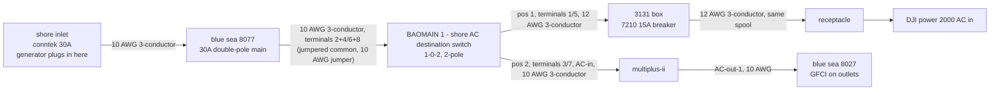
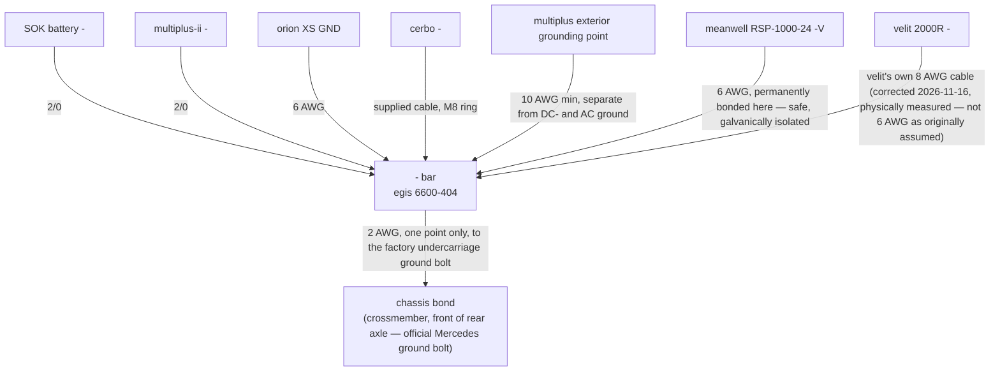
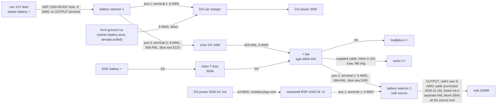
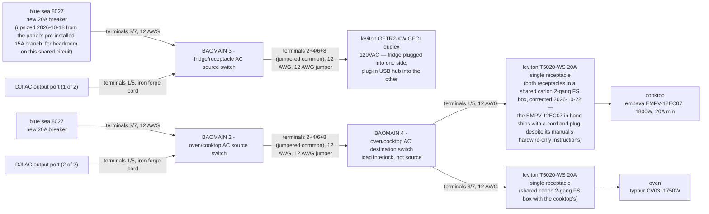
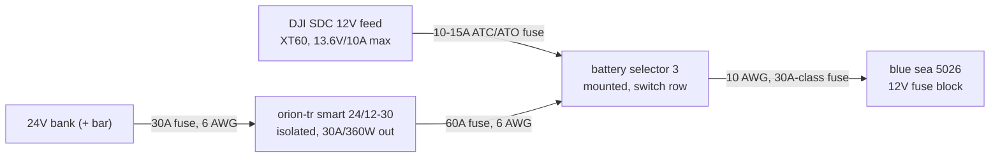
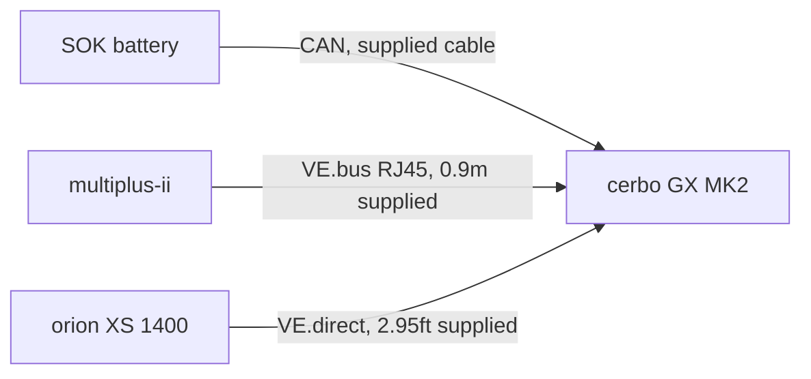

# electrical plan

last updated: 2026-10-03

one section per subsystem (matching the diagrams below), each leading with its diagram, then an installation checklist (ordered, check off as done), then a supplies checklist (`[x]` in hand, `[ ]` still needed). a returned item is removed from its supplies list entirely, not kept as a checked-off line. cable lengths and reel-sharing notes are inline on the relevant installation/supply line, not a separate table. open questions that anchor to one specific line are tagged inline as `(verify: ...)`; ones that don't are in "open questions" at the end. rejected or settled-either-way design alternatives are in "decided" at the end, so they don't get re-proposed. for the full history of how any of this got decided, `git log` is the change log — every change here has a commit message. for what's actually confirmed built, see README.md.

sections are ordered to match the real install sequence: ac input (wired, then held unenergized), then the DC backbone (negative before positive — that's the system's only ground reference and it goes in first, ending with the multiplus profile set and shore power plugged in), then the alternator (still part of dc positive and alternator), then back to ac input to finish (AC-out-1 to the 8027), then the kitchen AC loads and the velit (the back half of dc positive and alternator, concurrent with the kitchen) together, then the 12V bus, then data cables last. a few installation steps are flagged inline where this crosses section boundaries, since the sections themselves are grouped by diagram, not strictly by phase.

## tools required

- [x] DxCRIMP hex ferrule crimper, AWG 24-4
- [x] ferrule set, 166pc, AWG 1/0-12
- [x] [pro'skit 902-160 crimpro crimper](https://www.amazon.com/dp/B002PI6LU8), AWG 2-4-6 — for 6/4/2 AWG screw terminals
- [x] [IWISS battery cable lug crimping tool kit](https://www.amazon.com/IWISS-Battery-Crimping-Terminals-Stripper/dp/B09PYH9B4Q), AWG 8-4/0 — for the 2/0 ring lugs
- [x] [adhesive-lined 3:1 heat shrink tubing kit, assorted sizes](https://www.amazon.com/270-pcs-Adhesive-Assortment-MILAPEAK/dp/B0771K1Z7Q) — covers the range of gauges used across this build (2/0 down to 12 AWG), unlike single-size kits — on hand, 2026-11-16
- [x] cable cutter
- [x] inch-pound torque wrench
- [x] commercial electric (mastech) MS8922H voltage tester — AC/DC voltage and GFCI test only, **no continuity/resistance function**, confirmed from its [manual](https://www.manualslib.com/manual/1483854/Mastech-Ms8922h.html) — not sufficient on its own for this plan's continuity checks
- [x] [woods DMMW3 pocket multimeter](https://www.woodshomeproducts.com/product/pocket-auto-range-multimeter/), 10-function, CAT III 300V, UL listed — has resistance/continuity/diode test, confirmed capable of every continuity check called for in this plan. [manual](https://manuals.plus/asin/B071D9KNMM)
- [ ] 1-1/8" hole saw — confirmed this is for the blue sea 3131's strain-relief cable-entry hole (not the breaker itself — the 7210 mounts on included screws with a knockout, no drilling needed there), per the 3131's own [installation instructions](https://defender.com/assets/pdf/blue-sea-systems/980014250.pdf)

## conventions

**switch position convention** (2026-09-21): position 1 is always the DJI leg, position 2 is always the victron leg, on every switch that splits between the two systems (BAOMAIN 1, BAOMAIN 2, BAOMAIN 3, battery selector 1, battery selector 2, battery selector 3). matches the physical layout — DJI mounted driver side/left, victron gear passenger side/right — so turning a switch left (position 1) selects DJI and right (position 2) selects victron. exception: BAOMAIN 4 selects between two *loads* (oven/cooktop), not two sources, so this convention doesn't apply to it — which appliance sits on which leg is arbitrary.

**BAOMAIN transfer-switch terminal wiring**: jumper terminal 2 to terminal 4 (common hot) and terminal 6 to terminal 8 (common neutral) to turn the switch's two independent contact pairs into one proper double-throw. terminal 1/5 is the "position 1" leg; terminal 3/7 is the "position 2" leg. ground never goes through the switch — bond all grounds together directly. terminal is a clamp/box terminal (screw with a square pressure washer, fully removable — not a stud, so ring terminals don't fit), accepts 2.5-6.0mm² wire (about 14-10 AWG), torque 1.2 N·m — confirmed against the switch's own manual (SZW26-32/40 row: M4 terminal screw, 2.5-6.0mm² wire range, 1.2 N·m tightening torque), matching the Ith:32A nameplate already confirmed, see [reference/baomain-operating-intructions.pdf](../reference/baomain-operating-intructions.pdf). confirmed by continuity meter on BAOMAIN 1 (2026-10-14): terminals 2/4 and 6/8 are genuinely separate contacts, not already bridged internally — the jumper is required, not optional. confirmed method: twist the incoming wire and the jumper together (or crimp into one ferrule sized for the box) and insert both into the terminal's clamp cavity together — seats securely, tested on BAOMAIN 1. each switch's specific terminal assignment is in its own category's installation checklist below.

**AC wiring is the dangerous part of this build — have it inspected before energizing anything past the inlet, especially the BAOMAIN switches.**

## ac input

### installation

- [x] mount the shore inlet, blue sea 8077, BAOMAIN 1, and the multiplus (shore power disconnected throughout)
- [x] wire inlet → 8077 → BAOMAIN 1 common, 10 AWG 3-conductor throughout (10ft max on the inlet-to-8077 leg — 15ft southwire SOOW cord on hand; confirmed for the 8077 itself, not just by analogy from the 8027: blue sea's own 8077 product page states that if the panel is more than 10ft from the shore power inlet, measured along the conductors, an additional fuse/breaker must be installed within that 10ft — [bluesea.com/products/8077](https://www.bluesea.com/products/8077/AC_Main_30A))
- [x] install BAOMAIN 1's jumpers (terminal 2→4 hot, 6→8 neutral), 10 AWG, twisted together with the incoming hot/neutral from the 8077 and seated together in each clamp terminal — confirmed solid, 2026-10-14
- [x] land BAOMAIN 1 pos 2 (terminal 3/7) → multiplus AC-in, 10 AWG 3-conductor, ferruled into its spring-loaded push-in terminals (L/N/PE) — confirmed seated securely, 2026-10-15. pos 1 (terminal 1/5) = 3131/DJI branch, wired later
- [x] continuity check: no hot-neutral or hot-neutral-ground continuity anywhere wired so far; confirmed position 2 connects it and position 0 opens it — 2026-10-15
- [x] **hold here** — do not plug in shore power yet. go wire the DC backbone (dc negative and ground, then dc positive and alternator below) first; that section ends with the multiplus profile set and shore power plugged in, then comes back to finish this list — resolved, shore power plugged in and confirmed working 2026-10-17 (see dc positive and alternator)
- [x] multiplus AC-out-1 → 8027, 10 AWG 3-conductor, landing on the 8027's 30A main — landed 2026-10-18, confirmed against [blue sea's own 8027 wiring diagram](../reference/bluesea8027-instructions.pdf) (p.2): hot → the 30A breaker's line-in terminal, neutral → the AC neutral bus, ground → the AC safety ground bus (confirmed physically labeled, two separate bars, left=ground/right=neutral on this panel). **multimeter verification confirmed, 2026-10-18** (hot-neutral, hot-ground, neutral-ground, reverse-polarity LED check) — passed the same day as landing, before work moved on to the 12V bus (exact readings not recorded)
- [ ] wire the DJI AC-input branch (deferred): BAOMAIN 1 pos 1 → 3131 box → 7210 15A breaker → receptacle → DJI AC in, 12 AWG 3-conductor (resolved: the 7210 is confirmed single-pole, 15A AC/DC — [bluesea.com/products/7210](https://www.bluesea.com/products/7210/A-Series_White_Toggle_Circuit_Breaker_-_Single_Pole_15A). the 3131 has no threaded gland — cable enters through 2 snap-in ratcheting strain reliefs sized by a 1-1/8" drilled hole (see tools above), and both the breaker and grounding connections require ring terminals, not bare wire under a screw — confirmed from the 3131's own [installation instructions](https://defender.com/assets/pdf/blue-sea-systems/980014250.pdf). still open: the marine/UL rating of the 12 AWG triplex on hand — labeled "marine grade" with no UL/ABYC rating given, brand unknown)
- [ ] continuity check on the DJI AC-input branch before energizing it

### supplies

- [x] victron multiplus-ii 24/3000/70, 120V, 3000VA — main inverter/charger
- [x] blue sea 8077, 30A double-pole main — shore/generator main breaker
- [x] conntek 30A 125V stainless shore inlet
- [x] carlon E987N-3-HD enclosure, 4x4x4in — houses the 8077. [home depot](https://www.homedepot.com/p/Carlon-4-in-x-4-in-x-4-in-Gray-Electrical-PVC-Junction-Box-E987N-3-HD-E987N-3-HD/100404095) (verify: fit against the real 8077, whose 2.63x3.75in footprint came from retailer listings, not an official blue sea manual)
- [x] southwire 10 AWG 3-conductor SOOW cord, 15ft — shore inlet to 8077. [lowe's](https://www.lowes.com/pd/Southwire-10-AWG-3-Black-Power-Cord-By-the-Foot/50148254)
- [x] BAOMAIN 32A cam changeover switch, SZW26-32/D202.2D — BAOMAIN 1, shore AC destination. [amazon](https://www.amazon.com/Baomain-Universal-Changeover-SZW26-32-D202-2D/dp/B09MMQPQQH)
- [x] blue sea 3131 circuit breaker enclosure — DJI AC-input branch
- [x] blue sea 7210, 15A toggle breaker — DJI AC-input branch
- [x] 12 AWG 12/3 triplex marine wire, 20ft — DJI AC-input branch
- [x] [10 AWG triplex tinned marine wire, UL 1426](https://www.amazon.com/10-AWG-Triplex-Marine-Wire/dp/B06X6L6W2C) — 3 interior AC runs. picked over the plain "marine grade" wire already on hand for the kitchen circuits specifically because this one states a UL rating — the same open question flagged on the 12 AWG triplex below applies to any AC wire bought without checking for this. on hand, 2026-11-16
- [ ] [AMOMD weatherproof RV power outlet, 15A/20A, horizontal mount, 12/14 AWG push-on terminals](https://www.amazon.com/clp/B0DM1Q559K) — DJI AC-input branch, matches the 12 AWG triplex already on hand for this run
- [x] honda EU2200i generator, 1,800W — backup/shore AC source
- [x] jumper wire pair, 10 AWG — BAOMAIN 1's common. no separate purchase — cut from the already-owned southwire 10 AWG 3-conductor SOOW reel above, installed 2026-10-14 (see installation)

## dc negative and ground

### installation

- [x] mount the SOK — floor, passenger-side corner, parallel to the front wall, closest to the multiplus (a planned second SOK extends along the front wall toward the driver side) — mounted 2026-10-16
- [x] mount the positive and negative busbars tight against the SOK, passenger-side corner, same area as the multiplus and class T block — decided 2026-10-14, not left open: the high-current 2/0 connections (SOK, class T, multiplus) matter far more for being short than the meanwell's 6 AWG runs do for being shortened (under 1% voltage drop even stretched to 9ft). when the second SOK is added later (driver-side along the front wall), expect to replace SOK1's direct negative-bar cable with a SOK1→SOK2 jumper plus a new, longer SOK2→bar cable — SOK's own manual (parallel installation diagrams) taps the system's negative from whichever battery ends up *last* in the chain, not a fixed point, so this is a planned future rewire, not a sign the placement was wrong. both bars mounted and bolted down 2026-10-16
- [x] cut, crimp, pull-test, and heat-shrink the negative-side 2/0 cables — pacer 8ft black reel, both legs — confirmed pull-tested and heat-shrunk, 2026-10-16
- [x] wire the negative side first — this is the system's only ground reference, it goes in before anything else: SOK- → negative bar → multiplus-, 2/0 both legs — landed 2026-10-16
- [x] multiplus's separate exterior grounding point → negative bar — item F in Victron's Appendix A diagram, "primary ground connection M6 (PE)". upsized to 8 AWG (10 AWG called for, couldn't source it — fine, exceeds both the plan's spec and victron's own 4mm² minimum). landed 2026-10-16
- [x] single chassis bond off the negative bar → the official Mercedes M6 ground bolt at the crossmember in front of the rear axle (undercarriage), 2 AWG, pacer 10ft reel — routed and landed at both ends 2026-10-16 (busbar end: 2 AWG/3/8" lug sourced from west marine; ground-bolt end: seafit "#2-1/4" lug), replacing the originally-planned ceiling stud, which turned out not to be one of Mercedes' approved upfitter ground points at all. [reference/factory-chasis-ground.png](../reference/factory-chasis-ground.png) (Mercedes upfitter manual, §8.4.12): torque for M6 is **8 N·m ± 0.8 N·m** (about 64-78 in-lb — not the 120-140 in-lb figure used elsewhere in this build, which is sized for 3/8"/M8 hardware); maintain at least 3 full thread turns of protrusion; max 4 cable lug connections per bolt, radially distributed if more than one — not a concern here with a single lug
- [x] torque every negative-side stud just landed (egis busbar 120-140 in-lb; SOK terminals 9-11 N·m; chassis bond M6 ground bolt 8 N·m ± 0.8 N·m — three different torques, don't reuse settings between them) — 2026-10-16

### supplies

- [x] [egis powerbar 6600-404](https://www.westmarine.com/egis-mobile-electric-powerbar---four-m103-8inch-studs-4-circuits-8---600-amp-21976824.html) — negative busbar, replaces the 6600-804
- [x] pacer marine tinned copper battery cable, 15ft #6 black — negative-side runs
- [x] pacer marine tinned copper battery cable, 10ft #2 black — chassis bond
- [x] pacer marine tinned copper battery cable, 8ft #2/0 black — negative 2/0 runs
- [x] [seafit "#2-1/4" lug 5-pack](https://www.westmarine.com/seafit-heavy-duty-tinned-lugs-22320485.html) — chassis bond, ground-bolt end (1 needed, 4 spare)
- [x] 2 AWG, 3/8" hole lug — chassis bond, negative-bar end, sourced from west marine 2026-10-16
- [x] [pacer marine tinned copper primary wire, 8 AWG black, 25ft spool](https://www.westmarine.com/pacer-marine-tinned-copper-primary-wire-P021453725.html?dwvar_P021453725_variant_filter_2=100%27%20Spool&dwvar_P021453725_variant_filter_1=Black&dwvar_P021453725_variant_filter_3=8%20AWG) — multiplus exterior grounding point to negative bar (upsized from the originally-called-for 10 AWG, 2026-10-16 — see installation above)
- [x] [seafit "#8-#10" lug 5-pack](https://www.westmarine.com/seafit-heavy-duty-tinned-lugs-22320220.html) — multiplus's exterior grounding point end (M6 per Victron's own spec; already landed 2026-10-16, see installation above)
- [x] [seafit "#8-3/8" lug 5-pack](https://www.westmarine.com/seafit-heavy-duty-tinned-lugs-22320246.html) — negative bar end, matches the bar's 3/8" studs
- [x] 2/0 lug, M8 hole, x2 — SOK-, multiplus- (stale checkbox, corrected 2026-11-16: SOK- and multiplus- have been landed and energized since 2026-10-16, so these were clearly sourced and used — never marked at the time)
- [x] 2/0 lug, 3/8" hole, x2 — SOK-→-bar and -bar→multiplus- busbar ends (stale checkbox, same correction — this wiring is complete and energized)
- [x] (covered by the "#6-3/8" lug 5-packs tracked under dc positive and alternator for its XS-GND and meanwell−V ends)

## dc positive and alternator

### installation

- [x] continuity check: no continuity between the + and - bars — run 2026-10-16. result needs a caveat, not a flat pass/fail: bar-to-bar reads diode-like (continuity one polarity, open the other) with the multiplus connected — confirmed, by temporarily disconnecting multiplus- and re-testing (clean open both directions with it isolated), that this comes from the multiplus's own internal DC-input protection circuitry, not a wiring fault. the class T fuse isn't inserted yet, so SOK+ has no path to the positive bar at all right now and was never a factor. expect this same asymmetric reading on future bar-to-bar checks as long as the multiplus is connected — it's normal, not a regression
- [x] mount the class T fuse block near the busbars (fuse not inserted yet) — in place 2026-10-16
- [x] cut, crimp, pull-test, and heat-shrink the positive-side 2/0 cables — pacer 8ft red reel, all three legs — confirmed pull-tested and heat-shrunk, 2026-10-16
- [x] wire the positive side: SOK+ → class T fuse block → positive bar → multiplus+, 2/0 throughout — landed 2026-10-16, fuse itself correctly not yet inserted
- [x] torque every positive-side stud just landed (egis busbar 120-140 in-lb; class T block 190 in-lb max; SOK terminals 9-11 N·m) — 2026-10-16
- [x] install the class T fuse last; turn on the SOK (a small spark on connection is normal) — fuse installed and SOK powered on cleanly 2026-10-16 (RUN flashing per standby mode, ALM off, no faults)
- [x] set the multiplus's battery profile to lithium, absorption ≤27.6V — resolved 2026-10-17 via the MK3-USB-C interface (ordered after the cerbo/Remote Console path turned out not to expose this setting, see git history for that detour) connected straight into the multiplus's second VE.Bus port, computer running VictronConnect. lithium mode was already enabled; absorption changed from the 28.80V default to **27.60V**, float changed from 27.60V to **26.40V**, matching the figures worked out earlier (float derived from victron's own default 24V absorption/float/storage step pattern, applied to this build's lower absorption cap). charge current left at the 70A default — comfortably under the SOK's rated limits, no reason to change it. **remaining open item, same DVCC caveat as before**: SOK is not on victron's official Pylontech compatibility list (that list names real Pylontech models only — UP2500/US2000/US3000/etc.) — but SOK's BMS emulates the Pylontech CAN protocol closely enough that DIY users report the cerbo correctly auto-detecting it as a "Pylontech" device and running DVCC successfully, per multiple [DIY Solar Forum](https://diysolarforum.com/threads/sok-48v-100ah-victron-communication.120343/) and [Victron Community](https://community.victronenergy.com/t/pylontech-battery-cerbo-gx-pylontech/59161) threads — functional, not officially supported. before enabling DVCC, confirm this SOK unit auto-detects correctly (see the data cables section's detection check) rather than assuming compatibility from these reports alone
- [x] plug in shore power; verify with a multimeter (120V hot-neutral, 120V hot-ground, 0V neutral-ground); confirm the reverse-polarity LED is off before energizing any branch circuit — **first live energization, 2026-10-17**: reverse-polarity LED confirmed off before closing the 8077's main breaker. multimeter readings: hot-neutral ~112V, hot-ground ~112V, neutral-ground <1V — the two hot-referenced readings matching confirms correct wiring (no cross-fault), and the ~112V (vs nominal 120V) is voltage drop from the residential extension-cord source under load, not a van wiring issue; well within the multiplus's own 90-140V input range regardless. multiplus picked up the connection immediately and entered bulk charging (solid yellow "Bulk" LED, matching its documented indicator table) — first confirmation the lithium profile set the previous step is actually working. continue with the alternator steps below next — ac input's AC-out-1-to-8027 step comes after those, not before
- [x] pull the AEP fuse on the van feed (or disconnect the starter battery terminal) before touching any alternator wiring — the short segment between battery and fuse holder stays live even with the fuse pulled (this area shares the under-seat cavity with an existing audiocontrol LE5-1300 amplifier — route new DC cables clear of its wiring) — pulled 2026-10-16
- [x] mount battery selector 1
- [x] mount the orion XS — 2026-10-16
- [x] land the van feed (already run) on selector 1's "OUTPUT" terminal, M10 stud (as installed, under 15ft, confirmed marked 6 AWG; selector end is M10 — the "5/16"" lug size recorded for this run elsewhere was stale, left over from before the M10 correction) — 2026-10-16
- [x] selector 1 terminal "2" → XS IN, 6 AWG (position 2, victron leg; pacer 15ft red reel, shared across all 4 red 6 AWG runs in this section — this leg is under 6ft, under-bed run; XS's own terminal is a screw type, no lug) — landed 2026-10-17
- [x] **add a dedicated 60A ANL block on this leg, close to selector 1's terminal "2"** — reverses the earlier "no separate input-side fuse" decision, 2026-10-18: the van feed's 100A AEP fuse upstream is correctly sized for the DJI charger leg (DJI's own documentation calls for up to 70A draw with a 100A fuse) but is genuinely mismatched for this 6 AWG XS leg — the orion XS's own cable/fuse table recommends 60-70A for 6AWG, not 100A. since selector 1's two legs have different real current needs, one shared upstream fuse can't correctly protect both; each leg needs its own match. same part as the XS output fuse (blue sea 5123, 60A) — see supplies. **block mounted and leg re-landed through it, 2026-10-22** (selector 1 terminal "2" → block → XS IN); fuse element seated 2026-11-05 — this leg is now protected
- [ ] leave terminal "1" unconnected for now (DJI charger leg, deferred) — **no separate fuse needed here when it's eventually wired**: the van feed's existing 100A AEP fuse already matches DJI's own documented requirement for their charger (up to 70A draw, 100A fuse per DJI's own spec) — considered and rejected adding a redundant fuse here, 2026-10-18, since it would duplicate the same protection already in place with no added safety margin, and a lower value (e.g. 70A, right at the charger's rated max with no headroom) would actually risk nuisance tripping during normal full-power charging
- [x] XS OUT → 6 AWG → 60A ANL (5123) → positive bar (same 15ft red reel, under 6ft) — cable run and ANL block in place 2026-10-17. **fuse element seated 2026-11-05** (blue sea 5123, 60A) — this leg is now protected
- [x] XS GND → 6 AWG → negative bar (pacer 15ft black reel, shared with meanwell -V below, under 6ft) — landed 2026-10-17. **not the same ground as the DJI charger's, see below**; the orion XS's output lands on the SOK's own positive bar, so its return has to close the loop at the SOK's negative bar specifically, not chassis or any other ground point
- [x] front ground run (already pulled from the starter battery area to the switch box, 6 AWG) lands directly on the **DJI car charger's own ground terminal** — decided 2026-10-16, replacing an earlier plan to cap it off unused. the DJI charger's output goes to DJI power 2000, a completely separate system from the SOK, so its return belongs there, not on the SOK's negative bar — landing it on the SOK bus instead would bridge two systems this build otherwise keeps independent except through the selector switches themselves. the two chargers now share only the common + feed through selector 1; each keeps its own separate ground
- [x] continuity check with selector 1 OFF: confirm position 2 connects OUTPUT to "2" and nothing else, before reinserting the fuse — confirmed 2026-10-17: OUTPUT-to-"2" open, OUTPUT-to-"1" open, XS IN-to-negative-bar open — all clean with the selector off, as expected
- [x] reinsert the AEP fuse; switch selector 1 to position 2 — done 2026-11-05
- [x] configure the XS via VictronConnect, 2026-11-05: charger mode confirmed; battery preset set to lithium with absorption, float, and storage voltage manually overridden (absorption ≤27.6V, matching the multiplus's margin); input current limit set to **50A** (corrected from an earlier wrong "~60A" note — the Orion XS 1400's own hardware max is 50A on both input and output, per its nameplate; the 60A fuse protects the wire, it isn't itself an app-settable value). engine shutdown detection confirmed enabled, alternator type left on its default ("Smart Alternator") — the XS's own manual states this default works for most conventional and smart alternators alike, and changing it is a troubleshooting step for specific undercharging symptoms, not a decision needed up front. **if undercharging is ever observed**: watch the XS's live Input voltage reading across idle/revving/accessory-load conditions — steady ~14V means conventional alternator (switch to "Regular Alternator"), visible swings (12.5-15V per the manual) confirm smart alternator (current default is already correct)

the alternator branch above is done. the rest of this section (velit, below) happens alongside ac loads — not immediately next — since both are the same later phase of work; do ac input's AC-out-1-to-8027 step first if it isn't done yet.

- [ ] DJI AC out → meanwell AC input: molded-plug cord, 14 AWG minimum (no separate breaker needed — DJI's own output protection plus the meanwell's internal AC-input protection cover it; meanwell mounts driver-side wall, near the DJI, making this tap short)
- [x] mount battery selector 2 near the DC busbars (both battery selectors are already mounted, in the switch row, far passenger end, directly above the SOK)
- [ ] meanwell +V output → selector 2 terminal "1" (position 1, DJI leg), 6 AWG (pacer 15ft red reel, same as above — **this leg is longer than the rest of this reel's runs**: the meanwell is driver-side near the DJI, selector 2 is passenger-side above the SOK, so this crosses most of the 5.5ft front wall plus the height change — realistically 6-9ft, not under 6ft; measure before cutting)
- [x] + bar → 40A ANL (blue sea 5165) → selector 2 terminal "2" (position 2, victron leg), 6 AWG (same reel — this leg is confirmed short, selector 2 sits directly above the SOK/busbars) — mounted, wired, and fused 2026-11-16: the velit tap's ANL block (the 2nd of the 2 blue sea 5005 blocks obtained alongside the XS output's) is now mounted near the positive bar, 6 AWG landed from the bar through the block to selector 2 terminal "2", 40A fuse seated
- [ ] meanwell -V output → negative bar, 6 AWG (pacer 15ft black reel, same as XS GND — **also longer than assumed**, same driver-to-passenger crossing as the meanwell +V leg above, realistically 6-9ft; measure before cutting) — still deferred with the rest of the DJI/meanwell leg
- [x] selector 2 OUTPUT → velit, 2026-11-16: **corrected architecture** — not a cable with fuses built into its own ends as earlier assumed. a separate ANL fuse block (included with the velit, 50A fuse) is mounted alongside selector 2, wired OUTPUT → block → the velit's own supplied cable (**8 AWG, physically measured — corrects an earlier unverified assumption of 6 AWG**) → the unit. **why 50A here but only 40A on the bar-to-selector leg above, explained 2026-11-16**: these are two separately-chosen fuses on two different wire segments — the 40A fuse is this build's own choice for the 6 AWG bar-to-selector wire it built; the 50A fuse is Velit's own choice for the cable they supply. in position 2 (wired now), both sit in series and the smaller 40A fuse is the one that actually trips first on a fault, so the 50A fuse never has to act on this leg. once position 1 (meanwell, 40A rated output) is eventually wired, the 40A fuse plays no role in that path at all — the 50A fuse becomes the *only* protection downstream of the switch, and sitting above the meanwell's own 40A rating avoids nuisance-tripping under its normal output. **the unit end's second fuse, per the velit's own manual (§3.5), is resolved 2026-11-16**: this cable connects to the unit through a sealed, factory-molded male/female harness connector — there's no accessible splice point or anything custom to install there. whatever fusing the manual describes at that end is built into the sealed harness itself, not something the installer can see, verify, or service; the ANL block at the source end is the only fuse point actually accessible or actionable in this install. confirm the meanwell's output is set within its 20-26.4V range first before ever using position 1 (DJI leg) — not relevant yet, that leg is still fully deferred
- [x] **partial continuity check, victron leg only, 2026-11-16**: selector 2 off — no continuity anywhere on this leg; selector 2 in position 2 — continuous from the positive bar through to the velit's input, and the velit's negative reads continuous back to the negative bar. passed clean. **full check still pending**: confirming position 1 connects OUTPUT to the meanwell leg only (not this leg) can't be done until the meanwell leg itself is wired — revisit then, along with confirming the meanwell -V reads continuous to the negative bar regardless of position
- [x] **functional test, velit on the victron leg, 2026-11-16**: unit powered on and actually ran its AC (air conditioning) function off the direct 24V bus tap — working as expected. first confirmation this isn't just electrically sound but that the rooftop AC itself operates correctly on this source
- [ ] selector 1 pos 1 → DJI charger leg (deferred)

### supplies

- [x] SOK SK24V150PH, 24V 150Ah, 3.84kWh — main battery bank
- [x] victron orion XS 1400, 1-50A adjustable — alternator DC-DC charger
- [x] battery selector switch, 300A off-1-2 — selector 1, van feed to XS/DJI charger
- [x] battery selector switch, 300A off-1-2 — selector 2, velit source
- [x] egis powerbar 6600-404, 4-stud — positive busbar. [west marine](https://www.westmarine.com/egis-mobile-electric-powerbar---four-m103-8inch-studs-4-circuits-8---600-amp-21976824.html)
- [x] egis mobile electric 3912B class T fuse block, M8 studs — battery main fuse holder. [west marine](https://www.westmarine.com/egis-mobile-electric-class-t-fuse-block-225---400-a-sealed-21481650.html)
- [x] eaton/bussmann JJN-300 limitron class T fuse, 300A — battery main fuse. [west marine](https://www.westmarine.com/eaton-limitron-fast-acting-class-t-fuse-22185755.html)
- [x] 2x blue sea 5005 ANL fuse block, 5/16" studs — XS output fuse, velit direct-DC tap fuse
- [x] blue sea 5005 ANL fuse block, 5/16" studs — XS **input** fuse — ordered 2026-10-18, arrived and mounted 2026-10-22 (fuse element itself still needed — see supplies above)
- [x] [blue sea 5123, 60A ANL fuse](https://www.amazon.com/Blue-Sea-Systems-5123-Fuse/dp/B06XFFKD67) — XS output, seated 2026-11-05
- [x] [blue sea 5123, 60A ANL fuse](https://www.amazon.com/Blue-Sea-Systems-5123-Fuse/dp/B06XFFKD67) — XS input, added 2026-10-18 (2nd one, same part as output — need 2 total), seated 2026-11-05
- [x] [blue sea 5165, 40A ANL fuse](https://www.amazon.com/Blue-Sea-5165-40A-Fuse/dp/B008GLEMMW) — velit direct-DC tap, seated 2026-11-16
- [x] pacer marine tinned copper battery cable, 15ft #6 red — selector/XS/busbar positive runs
- [x] pacer marine tinned copper battery cable, 8ft #2/0 red — positive 2/0 runs
- [x] meanwell RSP-1000-24 — AC-to-24VDC supply for the velit, DJI leg
- [x] velit 2000R rooftop AC, 24V DC, 720W — rooftop air conditioner
- [ ] [iron forge 12/3 SJTW molded-plug cord, 15ft](https://www.amazon.com/Replacement-Supply-Extension-Universal-Appliance/dp/B0C5KHWHMT) — DJI AC output to meanwell, a third of the same cord already used for the two kitchen taps below (likely needs the longer ~15ft length, not 6ft: the DJI-to-switch-row distance is estimated 8-10ft by the cargo-area geometry, not tape-measured)
- [x] DJI power 2000 + expansion battery 2000 — secondary AC/DC power system
- [x] DJI super fast charger (DYS_DC1000) — alternator-to-DJI charger
- [x] seafit "#6-5/16" lug 5-pack — ANL block 6 AWG ends (XS output, velit tap)
- [x] 2x [seafit "#6-3/8" lug 5-pack](https://www.westmarine.com/seafit-heavy-duty-tinned-lugs-22320329.html) — busbar and selector 6 AWG ends (10 lugs covers all 9 ends, shared with dc negative and ground, 1 spare)
- [x] 2x [seafit "#2/0-5/16" lug 5-pack](https://www.westmarine.com/seafit-heavy-duty-tinned-lugs-22320667.html) — 6 M8-hole ends total (SOK+/-, multiplus+/-, both class T block ends), drilled from 5/16" to M8 (10 lugs covers 6 needed with 4 spare for a future second SOK) — stale checkbox, corrected 2026-11-16, same reasoning as above
- [x] 1x [seafit "#2/0-3/8" lug 5-pack](https://www.westmarine.com/seafit-heavy-duty-tinned-lugs-22320659.html) — 4 3/8"-hole busbar ends total (block→+bar, +bar→multiplus+, SOK-→-bar, -bar→multiplus-), no modification needed (5 lugs covers 4 needed with 1 spare) — stale checkbox, corrected 2026-11-16, same reasoning as above

## ac loads

### installation

- [x] mount BAOMAIN 3 and BAOMAIN 2 (BAOMAIN 4 not yet mounted — it goes in the kitchen cabinet, see below)
- [x] upsized the fridge+USB circuit from 15A to 20A, 2026-10-18 — a deliberate ceiling increase for headroom on this shared branch, not driven by the actual loads (fridge + USB outlet together are nowhere near 15A). wire from the kitchen to the rear already pulled for both kitchen circuits, 12 AWG
- [x] install a new 20A breaker in one of the 8027's open positions (not the panel's pre-installed 15A branch position, which this circuit no longer uses — that position is now free for something else, e.g. the still-undesigned water heater circuit) → BAOMAIN 3 terminal 3/7, 12 AWG (position 2) — landed 2026-10-22
- [x] install BAOMAIN 3's jumpers (terminal 2→4, 6→8), 12 AWG. pos 1 (terminal 1/5) = DJI AC output port, deferred. pos 2 (terminal 3/7) = 8027's new 20A breaker. common = the 20A fridge+USB circuit — landed 2026-10-22
- [x] BAOMAIN 3 common → leviton GFTR2-KW GFCI duplex, 12 AWG, landing on its **LINE** terminals (not LOAD — this is the only outlet on this run, LOAD is for daisy-chaining downstream outlets) — landed 2026-10-22
- [x] continuity check, fridge/USB branch (BAOMAIN 3), before energizing: position 0 open hot-neutral/hot-ground/neutral-ground; position 2 continuous breaker-to-duplex on both hot and neutral with no shorts; position 1 open (DJI tap still deferred) — passed 2026-10-22
- [x] live verification, fridge/USB branch: multiplus switched on (inverting off the SOK bank, no shore power connected — confirmed AC-out-1 passes through on multiplus state alone, so this validated the battery-inverter path specifically), 8027's new 20A breaker closed, BAOMAIN 3 to position 2 — hot-neutral ≈120V, hot-ground ≈120V, neutral-ground ≈0V, reverse-polarity LED off, GFCI test/reset confirmed working — passed 2026-10-22. **note for the oven/cooktop branch later**: shore power, if connected, passes through AC-out-1 regardless of the multiplus's on/off state — don't assume the multiplus being off means this panel is dead
- [x] install a new 20A breaker in one of the 8027's open positions → BAOMAIN 2 terminal 3/7, 12 AWG (position 2) — landed 2026-10-22 (checkbox missed at the time, corrected 2026-11-13 — see electrical/README.md's as-built note from that date)
- [x] install BAOMAIN 2's jumpers, 12 AWG. pos 1 (terminal 1/5) = DJI AC output port, deferred. pos 2 (terminal 3/7) = 8027's new 20A breaker. common = feeds BAOMAIN 4's common — landed 2026-10-22, same correction
- [x] mount BAOMAIN 4 and install its jumpers, 12 AWG. common = BAOMAIN 2's output. pos 1 (terminal 1/5) = cooktop's receptacle. pos 2 (terminal 3/7) = oven's receptacle (swapped from the original oven-pos1/cooktop-pos2 assignment, 2026-10-22, per preference — arbitrary either way, see the switch position convention note above) (BAOMAIN 4 mounts in the kitchen cabinet, ~4ft forward of the cargo area's front wall — outside the cargo area entirely) — mounted 2026-10-22, same correction
- [x] mount the carlon E9802E-5-HD 2-gang FS box in the kitchen cabinet near BAOMAIN 4; install both leviton T5020-WS single receptacles into it — one for the oven, one for the cooktop (corrected 2026-10-22: the cooktop was originally planned as hardwired direct, no receptacle, per its manual's own "requires hardwiring by a qualified technician — no plug" instruction, but the actual EMPV-12EC07 unit in hand ships with a cord and plug — going with the physical part in hand over the manual's generic text) — mounted 2026-10-22, same correction
- [x] BAOMAIN 2 common → BAOMAIN 4 common, 12 AWG — landed 2026-10-22, same correction
- [x] BAOMAIN 4 terminal 1/5 → cooktop's receptacle, 12 AWG — landed 2026-10-22
- [x] BAOMAIN 4 terminal 3/7 → oven's receptacle, 12 AWG — landed 2026-11-13, completing this leg and the whole oven/cooktop branch's wiring
- [ ] leave BAOMAIN 3 and BAOMAIN 2 terminal 1/5 unconnected (DJI AC-output-port taps, deferred)
- [x] continuity check, oven/cooktop branch (BAOMAIN 2/4): no continuity hot-neutral or either to ground; confirm BAOMAIN 4 position 1 energizes only the cooktop's receptacle and position 2 only the oven's receptacle, never both — passed clean, 2026-11-13
- [x] live verification, oven/cooktop branch: 8027's new 20A breaker closed, BAOMAIN 2 to position 2 (victron leg) — BAOMAIN 4 position 1 (cooktop) checked first: hot-neutral ≈120V, hot-ground ≈120V, neutral-ground ≈0V, reverse-polarity LED off at the cooktop's receptacle; then BAOMAIN 4 flipped to position 2 (oven) — same checks passed at the oven's receptacle, cooktop's receptacle confirmed dead — passed 2026-11-15. this branch is now live and confirmed safe to use
- [ ] 8027 backlight board → its own fused (1.0-2.0A) DC feed and ground, separate from everything in the AC schedule above. **confirmed 2026-11-16 from the 8027's own manual (§5, "Installation of Backlight System")**: this is the small board behind the panel that lights each breaker's label — negative to a DC ground, positive to "any DC positive supply, usually a switch that controls the vessel's other nighttime illumination" (i.e., tap the same switched circuit as the interior lights, not a dedicated always-on feed), fused 1.0-2.0A (matches the manual's own wiring diagram). voltage still not stated by the manual itself — likely fine at 24V by analogy to other blue sea backlight products (12-24V DC nominal, 32V max — [bluesea.com/products/8383](https://www.bluesea.com/products/8383/Backlight_System_13_pos_12-24V)), not confirmed for this exact board, so still worth a multimeter check before connecting. **deliberately deferred until the interior LED puck light circuit is run** — same reasoning as "tap the switched lighting circuit," so do this alongside that work rather than before it exists
- [x] confirmed 2026-10-18: the panel's 3 originally pre-installed 15A branches are now all free — the fridge/USB circuit moved off its 15A branch to a new 20A position, and the other 2 pre-installed 15A branches were never used. a real candidate for the still-undesigned water heater circuit (TBD throughout this file and README.md), once its actual wattage is known

**AC wiring is the dangerous part of this build — have it inspected before energizing.**

### supplies

- [x] blue sea 8027, main + 6, 30A main — AC branch panel
- [x] carlon E989N-CAR enclosure, 8x8x4in — houses the 8027. [home depot](https://www.homedepot.com/p/Carlon-8-in-x-8-in-x-4-in-Gray-Electrical-PVC-Junction-Box-E989N-CAR-E989N-CAR/100404099)
- [x] [BAOMAIN 32A cam changeover switch](https://www.amazon.com/Baomain-Universal-Changeover-SZW26-32-D202-2D/dp/B09MMQPQQH) — BAOMAIN 3, fridge/receptacle AC source
- [x] [BAOMAIN 32A cam changeover switch](https://www.amazon.com/Baomain-Universal-Changeover-SZW26-32-D202-2D/dp/B09MMQPQQH) — BAOMAIN 2, oven/cooktop AC source
- [x] [BAOMAIN 32A cam changeover switch](https://www.amazon.com/Baomain-Universal-Changeover-SZW26-32-D202-2D/dp/B09MMQPQQH) — BAOMAIN 4, oven/cooktop AC destination
- [x] 2x blue sea 7214, 20A toggle breaker — 1 for the oven/cooktop circuit, 1 (the former spare) now used for the upsized fridge+USB circuit, 2026-10-18 — no spare remains
- [x] 12 AWG 12/3 triplex marine wire, 20ft — oven/cooktop circuit (verify: marine/UL rating — labeled "marine grade" with no UL/ABYC rating given)
- [x] [12 AWG wire](https://www.amazon.com/dp/B0BD865DQ5) — arrived and used 2026-11-13 to finish the BAOMAIN 4-to-oven-receptacle leg
- [x] 12 AWG 12/3 triplex marine wire — fridge+USB circuit, upsized from 14 AWG 2026-10-18, confirmed 3-conductor triplex matching the oven/cooktop circuit's wire type. pulled from the kitchen to the rear of the vehicle for both kitchen circuits
- [x] [iron forge 12/3 SJTW molded-plug cord, 15ft](https://www.amazon.com/clp/B0C5KHWHMT) — DJI AC-output tap, fridge/USB leg
- [x] [iron forge 12/3 SJTW molded-plug cord, 6ft](https://www.amazon.com/clp/B0B8DPVW57) — DJI AC-output tap, oven/cooktop leg
- [x] typhur CV03 sync oven, 1750W — kitchen oven
- [x] empava EMPV-12EC07 induction cooktop, 1800W — kitchen cooktop. corrected 2026-10-22: planned as hardwired per the manual, but the unit in hand ships with a cord and plug — now receptacle-fed like the oven
- [x] deaprull D31A fridge, 35-45W, 120VAC — kitchen fridge
- [x] [leviton GFTR2-KW 20A/125V GFCI duplex receptacle](https://www.homedepot.com/p/Leviton-20-Amp-125-Volt-Duplex-SmarTest-Self-Test-SmartlockPro-Tamper-Resistant-GFCI-Outlet-White-GFTR2-KW-R92-GFTR2-0KW/205999867) — fridge + USB circuit, 2026-10-18. one duplex outlet serves both: fridge plugs into one side, a plug-in USB hub/outlet (not a dedicated wall receptacle) into the other — resolves the separate "USB charging outlet" line below, no dedicated USB wall outlet needed
- [x] [desktop power grommet, 100W USB-C, 5 AC outlets + 4 USB ports](https://www.amazon.com/dp/B0FPCBFP4Y) — arrived and installed 2026-11-13, replaces the earlier generic USB-hub placeholder. plugs into the GFCI duplex's second socket via its own 6ft/14AWG cord, not hardwired. **hole size discrepancy, not yet an issue**: the amazon listing says "4-Inch Hole," but the unit's own manual ([reference/desktop-power-grommet.pdf](../reference/desktop-power-grommet.pdf)) specifies a 3.9in hole with 100mm clearance depth underneath — worth knowing if the fit ever seems loose, not necessarily a problem on its own since the lock-ring clamp has some tolerance. own AC rating 125V/15A/1500W total across its 5 outlets, comfortably within the 20A branch it's plugged into
- [x] 2x [leviton T5020-WS 20A/125V single tamper-resistant receptacle](https://www.homedepot.com/p/Leviton-20-Amp-125-V-Tamper-Resistant-Single-Outlet-Receptacle-White-1-Pack-T5020-WS-R52-T5020-0WS/202066676) — one for the oven, one for the cooktop, 2026-10-22. replaces the earlier CR020-W duplex plan: separate single receptacles instead, for a clean split between the two appliances coming out of BAOMAIN 4
- [x] [carlon E9802E-5-HD 2-gang FS box](https://www.homedepot.com/p/Carlon-2-Gang-32-cu-in-3-4-in-Electrical-PVC-Type-FSE-FS-Box-E9802E-5-HD-E9802E-5-HD/100404110) — houses both T5020-WS receptacles
- [ ] [blue sea 3102100, A-series ELCI/GFCI double-pole 120V 30A breaker](https://www.amazon.com/Blue-Sea-Systems-3102100-Circuit/dp/B00H2BY3FI) — 8027 AC-out-1, matches the 30A main breaker position's rating
- [x] jumper wire pair, 12 AWG — BAOMAIN 3's common (upsized from 14 AWG 2026-10-18). no separate purchase — cut from the already-owned 12 AWG 12/3 triplex reels above
- [x] jumper wire pair, 12 AWG — BAOMAIN 2's common. no separate purchase — cut from the already-owned 12 AWG 12/3 triplex reels above
- [x] jumper wire pair, 12 AWG — BAOMAIN 4's common. no separate purchase — cut from the already-owned 12 AWG 12/3 triplex reels above

## 12V bus

### installation

- [x] mount battery selector 3 in the switch row (order recorded 2026-10-22, see README.md) — mounted
- [x] mount the orion-tr smart 24/12-30, far end of the switch row — mounted. that end of the row sits directly above the SOK (same reason battery selectors 1 and 2 are there), so this is under a foot from the busbars — both input and output legs are trivially short runs
- [x] **relocated, 2026-11-06**: the orion-tr's 12V output ANL block (the 2nd of the three blocks that arrived 2026-10-22) was originally mounted in the switch row, immediately ahead of selector 3 — moved to sit right at the orion-tr's own OUTPUT terminal instead, same reasoning already applied to the 24V input block at the busbar: protect the wire as close to its source as possible, rather than at the far end near the switch it feeds. **fuse (blue sea 5123, 60A) seated 2026-11-12** — this leg is now protected
- [x] seat the orion-tr's 24V input fuse (blue sea 5164, 35A), 2026-11-12 — first power-on for this unit: VictronConnect read Input Voltage 27.6V, confirming the input leg and the busbar ANL block are both good
- [x] **found and fixed, 2026-11-12**: VictronConnect initially reported the unit off, "Output disabled due to: Remote input inactive" — unrelated to either fuse. the orion-tr ships with a factory wire-loop bridge on its separate 2-pin REMOTE connector (L/H pins, not the main 4-pin IN/OUT block) that makes it "always on" per the manual (§4.7); that bridge wasn't making contact, likely knocked loose during mounting. reseated the connector, confirmed active in VictronConnect before seating the output fuse
- [x] confirm VictronConnect's active mode: already set to **Power Supply Mode** (not Charger mode) — correct for this application, since the orion-tr feeds the 5026's load bus (USB panels, LED pucks, starlink), not an actual battery. no mode change needed
- [x] mount the orion-tr's 24V input ANL block (the 3rd block) at the positive busbar, not in the switch row — standard practice, protects the wire close to its source rather than close to the orion-tr. mounted 2026-10-22, block only — no wiring landed yet, no fuse element in hand
- [ ] confirm the fuse holder on hand is the right format (10-15A ATC/ATO inline, not ANL — ANL fuses aren't made that small)
- [ ] DJI SDC feed → selector 3 terminal "1", through the 5065 holder/10-15A ATC fuse; DJI SDC negative → negative bus, direct (superseded 2026-11-06: originally planned as a direct DJI-to-5026 feed before selector 3 was added to this leg — now goes through the switch like everything else, see below)
- [x] wire the USB panel branch: only 2 USB panels installed (not 4 as originally budgeted — no plan to add more right now), wired as one shared branch off a single 5026 position — one wire run from the 5026 to the first panel, daisy-chained from panel 1's terminals to panel 2 (electrically parallel, sharing one feed and one fuse position), 14 AWG, already landed. **fused at 15A, not the originally-planned 10A, 2026-11-15**: each panel is rated 108W (9A at 12V), so a shared 10A fuse would sit right at one panel's own rated max with zero headroom for two panels sharing it — a single 10A fuse protecting a combined-up-to-18A branch risked nuisance tripping under realistic use. 15A stays within typical 14 AWG ampacity (commonly cited 15-20A for short marine/automotive runs, not confirmed for this specific wire product) while giving real headroom over one panel's draw; it will still trip if both panels hit their full rated 108W simultaneously, judged acceptable since that's an unrealistic worst case for USB charging, not typical sustained use
- [x] starlink branch: real watts researched 2026-11-15 (manufacturer/field data, not a guess) — 12-48V DC input confirmed, typical draw ~15-40W, peak/heavy-load/snow-melt mode up to **60W** (a real sustained mode, not just a momentary startup spike — sized around this, not the lower typical draw). at 12V that's a 5A worst case; 14 AWG wire already run (comfortably covers 5A). fused at **10A ATC**, giving solid headroom (device never exceeds 50% of the fuse's rating even at peak) — wired, live, and confirmed operational, 2026-11-15
- [ ] hold the LED puck branch until its actual watts are known — don't guess a fuse size
- [x] continuity check, selector-3-to-5026 leg: selector 3 off — no continuity anywhere on the new run; selector 3 in position 2 — continuous from the 5026's main input through to the orion-tr's output, no shorts to negative anywhere along the path. passed clean, 2026-11-12
- [x] voltage check: confirm the 5026 reads close to 13.6V at a populated branch position — confirmed 13.6V, 2026-11-15, with selector 3 in position 2 (orion-tr/victron leg — the only source wired and fused so far, DJI leg still deferred). this is the first live, end-to-end confirmation of the whole chain: 24V bank → orion-tr → selector 3 → 7720/5250 MIDI fuse → 5026 → USB panel branch
- [x] wire the orion-tr's 24V input leg, 6 AWG: positive bar → the busbar ANL block → orion-tr INPUT(+); negative bar → orion-tr INPUT(−), direct, no fuse. landed 2026-11-05. gauge note: real specs confirmed from [the orion-tr's own manual](../reference/34439-Orion-Tr_Smart_DC-DC_Charger-pdf-en.pdf)'s minimum-cable-gauge table (p.5), corrected 2026-10-22 — an earlier read of this table rounded wrong: 24V input side (30A fuse) calls for 6mm² up to 2m, 16mm² at 5m+; 12V output side (60A fuse) calls for 10mm² up to 2m, 16mm² at 5m+. **going with 6 AWG for both legs regardless of exact run length**: it's the terminal block's own documented max cable size, it covers the manual's table at any distance up to 10m, and it's the same gauge, reel, crimper, and lugs already used for every other leg in this section. **not reverse-polarity protected — damage from reverse polarity voids warranty and cannot be repaired**; this leg has no fuse seated yet, don't energize it
- [x] wire the orion-tr's 12V output leg, 6 AWG: orion-tr OUTPUT(+) → the relocated ANL block (now at the orion-tr's own output terminal) → selector 3 terminal "2"; orion-tr OUTPUT(−) → negative bus, direct, no fuse. landed 2026-11-06 (an earlier 2026-11-05 note claiming this was done was premature — corrected, this is the real completion date). same polarity caution as the input leg; no fuse seated yet, don't energize
- [x] selector 3 output to 5026 main input, 10 AWG, working from the 5026 end back: #8-screw ring terminal → 5026 main input; negative → 5026 negative bus → main negative bar. landed 2026-11-12
- [x] mount the blue sea 7720 MIDI block in the switch row, near selector 3 — mounted 2026-11-12
- [x] continue the same 10 AWG run from the 5026 end: M8 (ancor) lug → 7720 output stud — landed 2026-11-12
- [x] insert the blue sea 5250 30A MIDI fuse into the 7720 — seated 2026-11-12
- [x] M8 (ancor) lug on a new 10 AWG length → 7720 input stud; M10/3/8" lug on the other end → selector 3's OUTPUT terminal — landed 2026-11-12, completing the selector-3-to-5026 leg end to end
- [ ] **ships with a remote on/off wire loop pre-installed (always-on when powered)** — leave as-is, since battery selector 3 is this leg's actual on/off control. engine shutdown detection (the manual's section 5) does not apply to this installation — that feature is for alternator/starter-battery inputs, not relevant since this unit's input here is the 24V house bank

### supplies

- [x] blue sea 5026, 12-circuit fuse block — 12V bus (LED pucks, USB panels, starlink)
- [x] victron orion-tr smart 24/12-30 isolated, 30A/360W — 5026 bus's victron-leg converter. [amazon](https://www.amazon.com/dp/B086R9ZVK5)
- [x] [battery selector switch, 300A off-1-2](https://www.amazon.com/dp/B0C85R2VD2) — selector 3, 5026 bus source
- [ ] [blue sea 5065, waterproof in-line ATO/ATC fuse holder](https://www.amazon.com/Blue-Sea-Systems-Waterproof-Holder/dp/B004ZIUA62) (12 AWG pigtails, 30A max holder rating — fuse itself sold separately) + 10-15A ATC fuse — DJI SDC to 5026 feed (verify: confirm the fuse states a real AIC rating when bought — ABYC E-11 table V isn't freely published and doesn't apply cleanly here anyway, since this feed's actual source is DJI's own 10A-current-limited, BMS-protected battery, not a raw bank; standard ATC/ATO fuses, typically 1000-6000A AIC at 32V, are almost certainly adequate)
- [x] [blue sea 7720, MIDI/AMI safety fuse block](https://www.amazon.com/Blue-Sea-Systems-Safety-Block/dp/B004T1VYLA) + [blue sea 5250, 30A MIDI/AMI fuse](https://www.amazon.com/Blue-Sea-5250-MIDI-Fuse/dp/B00ENKXWJ4) — selector 3 output to 5026 main input, added 2026-11-05, switched from an ATC/5065 holder to MIDI format same day for better panel-mount consistency with the ANL blocks already in this row (bolt-down, IP66 sealed, vs. a dangling inline holder): a real gap caught mid-install — the orion-tr's 60A ANL block only protects the 6 AWG orion-tr-to-selector-3 leg, not this separate 10 AWG selector-3-to-5026 leg, which needs its own 30A-class protection regardless of which source (DJI or orion-tr) selector 3 has picked. terminal stud size confirmed M8 x 1.25 (120 in-lb/13.56 N-m recommended torque) from [the 7720's own official spec sheet](../reference/7720.pdf), added 2026-11-13 — matches the Ancor M8 ring lugs already used. mounted, wired, and fused 2026-11-12, see installation above
- [x] [ancor 12-10 AWG, 5/16" (M8) heat-shrink ring terminal, 3-pack](https://www.amazon.com/Ancor-12-10-Gauge-Shrink-Terminal/dp/B00PAJHIAG) — both ends of the selector-3-to-5026 leg at the 7720 block, 2 of 3 used 2026-11-12 (checkbox was stale, corrected 2026-11-15 — both lugs were already landed per the installation steps above), 1 spare remains
- [x] blue sea 5026 branch fuse, 1x 15A ATC — USB panel branch (corrected 2026-11-15 from the originally-budgeted 4x 10A: only 2 panels are actually installed, sharing one branch — see installation above. sourced from a mixed ATC fuse kit already on hand, no dedicated purchase needed)
- [x] 10 AWG lug, 3/8" hole — **corrected 2026-11-16, this "x3" figure was wrong from the start**: only selector 3's OUTPUT terminal actually uses this spec (landed 2026-11-12, covered by the Ancor 3-pack above). terminal "2" used a different lug (6 AWG, #6-3/8, since that leg is 6 AWG not 10 AWG). terminal "1" (DJI SDC leg) is still deferred and will need its own lug once wired — not necessarily this same spec, since that feed is a much smaller gauge
- [x] blue sea 5005 ANL fuse block + 35A ANL fuse (5164, nearest standard size above the manual's 30A spec) — orion-tr 24V input side (bank to converter). block arrived and mounted 2026-10-22, fuse seated 2026-11-12
- [x] blue sea 5005 ANL fuse block + 60A ANL fuse (5123) — orion-tr 12V output side (converter to selector 3). block arrived, mounted (relocated 2026-11-06), fuse seated 2026-11-12
- [x] 6 AWG cable — orion-tr input and output legs, both sides. corrected 2026-10-22 from an earlier wrong "10 AWG" read of the manual's table (see installation above) — already covered by the pacer #6 red/black reels on hand for this section, no separate purchase needed

## data cables

### installation

- [x] cerbo power (Power in V+) → + and - bars, supplied cable with an inline 3.15A slow-blow fuse already built in — pulled forward early, 2026-10-16, to unblock configuring the multiplus without needing an MK3-USB (see "dc positive and alternator" above and "set the multiplus's battery profile" there). the M8 ring eyes fit the 3/8" bar studs fine, despite the size mismatch flagged earlier — confirmed by direct test, not worth re-terminating
- [x] dedicate one of the cerbo's 2 VE.Can ports to the SOK; set the port profile — labeled **"CAN-bus BMS LV (500 kbit/s)"** in this firmware's Remote Console menu (Settings → Connectivity → VE.Can port 1/2 → CAN-bus Profile), not the plain "BMS-Can" the cerbo manual's prose uses — "LV" distinguishes it from a high-voltage EV-pack profile, correct for this 24V system. terminate with one of the 2 included VE.Can terminators, plugged into the port's other (unused) RJ45 jack — done 2026-11-13
- [x] SOK → cerbo, CAN, SOK's own supplied "GX devices to Battery BMS communication cable" (2000mm, RJ45 one end, SOK's 8-pin circular connector the other) — identified 2026-11-12 from the SOK's own manual (§3.2.2): RJ45 end → cerbo's VE.Can port; circular end → SOK's **Link IN** port (not Link OUT — the manual's own parallel-install diagrams confirm "IN" is the GX-device-facing port). landed 2026-11-13
- [x] plug the SOK's included "communication resistance" terminator (an RS485/CAN termination resistor built into a connector stub, not a spare/dust cap as first guessed) into the SOK's **Link OUT** port — per the SOK manual's own instruction, this goes on whichever battery sits at the farthest end of the chain from the GX device; with only one SOK installed, that's this one. **when the second SOK is added later**: move this resistor to the new battery's Link OUT, and connect this battery's OUT to the new battery's IN with the included "Line of Parallel" cable (750mm) instead. **note**: this item doesn't appear on the corresponding page of the V-2.0 PDF manual on file ([reference/SK24V150PH.pdf](../reference/SK24V150PH.pdf)) — confirmed from the physical V-1.0 printed manual instead, a real discrepancy between manual revisions worth knowing about. landed 2026-11-13
- [x] multiplus → cerbo, VE.bus RJ45, 0.9m supplied — pulled forward early, 2026-10-16, same reason as above
- [x] orion XS → cerbo, VE.direct, 2.95ft supplied — landed 2026-10-17 (pulled forward early, alongside the multiplus VE.Bus and cerbo power connections already done; the XS itself isn't powered yet, still waiting on its output-side 60A ANL fuse)
- [x] power the cerbo only from "Power in V+" (8-70VDC) — never from a multiplus AC-out — already satisfied, see the Power in V+ connection above, never wired any other way
- [x] turn DVCC on — enabled 2026-11-13 (Settings → System Setup → Charge Control → DVCC). confirmed a real tradeoff in the process, not just a monitoring upgrade: the cerbo manual's own description says DVCC "is set and locked according to the manufacturer's specifications" once a compatible BMS-Can battery is connected — this **overrides the multiplus's and orion XS's manually-set 27.6V absorption margin** (see "decided" section below) back up to the SOK's spec'd 28V, confirmed directly via the SOK BATT device's Parameters page: CVL 28.00V, CCL 15.0A, DCL 150A. CCL reading lower than the SOK's rated ≤150A standard charge current at the time, but that's expected, dynamic behavior, not a problem — the battery was at 100% SOC and BMS units commonly taper charge current near full. **decided to keep DVCC on**: the dynamic, battery-aware charging (current tapering near full, real BMS-reported limits instead of static per-charger numbers) was judged worth losing the specific 27.6V longevity margin for. "Limit managed battery charge voltage" was deliberately left disabled — the manual warns it's intended only for initial multi-battery balancing and may cause undesirable side effects if used otherwise, so there's no supported way to keep DVCC on and still cap below the manufacturer's spec
- [x] confirm the SOK auto-detects as a "Pylontech" device in the cerbo's device list — confirmed 2026-11-13: shows up as "SOK BATT" (not literally labeled "Pylontech" in this view) reporting live data — 100% SOC, 27.25V — confirming the CAN link and Pylontech-emulation protocol are actually working, which was the real point of this check

### supplies

- [x] victron cerbo GX MK2 (PN BPP900450110) — system monitor, CAN/DVCC hub. ships with its own power cable (inline 3.15A fuse, M8 rings) — powered early from the busbars and VE.Bus-connected to the multiplus (both landed 2026-10-16), originally to try configuring the multiplus without an MK3-USB — turned out not to work (see "dc positive and alternator" above), but both connections are needed for this section anyway, nothing wasted
- [x] [victron interface MK3-USB-C (VE.Bus to USB-C)](https://www.amazon.com/gp/product/B0BNBVKSTH) — used to set the multiplus's lithium battery profile via VictronConnect on a mac, 2026-10-17. uses a standard straight-through RJ45 patch cable (confirmed, not a proprietary Victron pinout) — borrowed the cerbo's cable for this since a dedicated second one wasn't on hand
- [x] victron VE.direct cable, 2.95ft — orion XS to cerbo
- [x] victron RJ45 UTP cable, 0.9m — multiplus to cerbo
- [x] SOK's included "GX devices to Battery BMS communication cable," 2000mm — SOK Link IN to cerbo VE.Can, identified 2026-11-12
- [x] SOK's included "communication resistance" terminator — SOK Link OUT, identified 2026-11-12 (see installation note on manual-revision discrepancy)
- [x] SOK's included "Line of Parallel" battery-to-battery communication cable, 750mm — spare for the planned second SOK, not needed yet

## open questions

items that don't anchor to one specific installation step. everything else is tagged inline as `(verify: ...)` on the relevant line above.

- XS engine shutdown detection, Sprinter-specific risk: this 2021 Sprinter's V6 (OM642) is confirmed to have a smart/variable-voltage alternator (2019+ Sprinter V6es do, per multiple sources — not just a safe-default assumption), so "Smart Alternator" is the factually correct VictronConnect setting. but several Sprinter+Orion-XS owners report the smart alternator's voltage can dip low enough during normal driving that the XS mistakes a running engine for a stopped one and cuts back charging — the same failure mode the XS's own manual describes in its Euro 6 section. **revisit after the next drive**: connect VictronConnect (or check the History/Graph screen afterward) and watch for charging dropouts — Bulk/Absorption LED going dark or charge current dropping to 0A — while the engine is clearly running. if that happens, two fixes other Sprinter owners use: disable engine shutdown detection entirely (input voltage lock-out still protects the starter battery), or wire the alternator's D+ signal to the XS's remote on/off H-pin as a more reliable trigger than voltage sensing

- velit refrigerant charge amount: confirmed contradiction, both figures straight from the manual — spec table (p.4) says 500g R32a for the 24V variant, troubleshooting section 5.2 (p.12) says 410g for 24V — [reference/Velit_2000R_User_Manual_2609.pdf](../reference/Velit_2000R_User_Manual_2609.pdf). not resolvable from the document alone; contact velit support (support@velitcamping.com, per the manual's own intro page) for the real figure before any refrigerant service rather than trusting either number
- water heater wattage (ecosmart eco mini 4): resolved without needing to buy it — manufacturer spec is 1440W / 12A / 120V, confirmed at [ecosmartus.com](https://www.ecosmartus.com/product/ecosmart-eco-mini-4-gallon-tank). 12A continuous is right at 80% of a 15A breaker (NEC's continuous-load derate threshold) — worth a 20A branch instead of reusing one of the freed 15A positions, same reasoning as the fridge+USB circuit's upsize. added to README.md's load budget; circuit source/breaker/receptacle still TBD

## decided

settled questions and rejected alternatives, kept here so they don't get re-proposed. the live design above is the current answer; this is why.

- no ATS, no smartshunt — manual switches and the SOK's own CAN-based state-of-charge reporting cover this instead
- orion XS 1400 is the alternator DC-DC charger — not the orion-tr smart 12/24-15, which was returned (a different orion-tr model, the smart 24/12-30, is the unrelated 12V-bus converter above)
- no second generator inlet — the generator plugs into the shore inlet
- SOK charged at ≤27.6V absorption, slightly below its own 28V spec — a deliberate margin, not a bug (trading a sliver of top-end capacity for longer cell life, standard practice for lithium packs). **superseded 2026-11-13**: with DVCC now on, the cerbo locks charging to the SOK's own BMS-reported Charge Voltage Limit (28.00V, confirmed via the device's Parameters page) regardless of what's manually set on the multiplus or orion XS — this margin no longer actually applies. kept DVCC on anyway, trading this specific margin for real-time BMS-aware charging (current tapering near full, live CCL/DCL instead of static per-charger numbers) — a deliberate choice, not an oversight
- velit: a pure direct-DC-only feed (skipping the DJI leg entirely) was not adopted, since it would drop the velit off the dual-source pattern every other major load follows. the hybrid design above (selector 2: direct 24V tap or DJI-fed meanwell) was adopted instead, recovering about 17% round-trip conversion loss on the battery leg while keeping both sources
- BAOMAIN 1 kept as the shore AC destination switch rather than replaced with a direct multiplus feed plus a separate DJI breaker — that would lose the interlock (nothing would stop both systems drawing from shore at once) and the neutral isolation
- no separate 4 AWG/80A ANL (5124) run for the XS — it shares the already-installed DJI-charger feed via selector 1 instead
- cerbo powered only from "Power in V+", never a multiplus AC-out — victron warns this can deadlock the system after a fault, since neither device can restart the other
- victron lynx distribution center not adopted — functionally redundant with the owned egis busbars/class T block/ANL blocks, costs more, and its shunt variant duplicates the SOK's own CAN-based monitoring
- BAOMAIN 1 can't be wired for simultaneous dual-bank charging — this switch family has no "both" position, and the combined draw would exceed the shore/8077 main anyway. alternate the switch position by night instead
- busbar downsized from the 8-stud egis 6600-804 to a second 4-stud 6600-404 (matching the positive bar) — stud length confirmed at 1-1/4", enough to stack 3 ring lugs per stud
